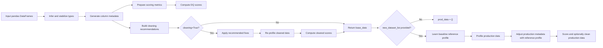

# Cleanalytix

Profiling, scoring, cleaning, and production-quality monitoring for pandas tabular data.

[](https://pypi.org/project/cleanalytix/)
[](https://pypi.org/project/cleanalytix/)
[](./LICENSE)

Cleanalytix is a pandas-first data quality library for teams that need more than a one-off profiling report, but do not want to wire together separate tools for scoring, cleaning, recommendations, and production drift checks.

The main entrypoint, `Run_DQ_Pipeline`, accepts one or more baseline datasets and can optionally compare them against matching production/new datasets. It returns structured pandas DataFrames for scores, metadata, recommendations, cleaning changes, before/after summaries, and production monitoring signals.

```python
from cleanalytix import Run_DQ_Pipeline
```

A lowercase alias is also available:

```python
from cleanalytix import run_dq_pipeline
```

Both names call the same pipeline.

## Why Cleanalytix?

Most tabular data quality work ends up split across notebooks, ad hoc checks, and manual cleanup scripts. Cleanalytix keeps that workflow in one reproducible pipeline:

| Need | What Cleanalytix provides |
| --- | --- |
| Understand a dataset quickly | Column-level profiling, missingness, uniqueness, outliers, type errors, whitespace issues, rare categories, duplicate percentage, and distribution metrics |
| Turn quality metrics into one score | Dataset-level DQ scores with configurable thresholds, weights, and scoring modes |
| Get actionable next steps | Rule-based cleaning recommendations with stable rule IDs and issue names |
| Clean safely | Optional non-interactive or interactive cleaning with a change log |
| Compare production data | Baseline vs production/new data paths with PSI, JS divergence, and reference-aware production metadata |
| Preserve outputs | A stable result dictionary with named DataFrame artifacts for downstream reporting |

Cleanalytix is intentionally library-shaped. It does not require a dashboard server, database connection, or custom runtime. If your data is in a pandas DataFrame, you can run the pipeline.

## Features

- Baseline dataset profiling and scoring
- Multiple dataset support through list-based inputs
- Optional production/new dataset monitoring
- Optional automatic cleaning
- Optional interactive cleaning prompts
- Custom business rules per column
- Configurable DQ thresholds
- Configurable metric weights
- Linear and exponential scoring modes
- Type inference for baseline and optional type inference for production data
- Stable output structure for reports, notebooks, tests, and validation runs
- Real-world validation workflow with reproducible dataset placement instructions

## Pipeline Flow



The same output contract is preserved across the supported execution paths:

- baseline only
- baseline with cleaning
- baseline plus production/new data
- baseline plus production/new data with cleaning
- optional custom rules
- optional thresholds
- optional weights
- optional `infer_types_for_new`
- optional interactive cleaning

## Installation

Install from PyPI:

```bash
pip install cleanalytix
```

For local development from the GitHub repository:

```bash
git clone https://github.com/Probot-DATA/Cleanalytix_Repo
cd Cleanalytix_Repo
pip install -e ".[dev]"
```

Runtime dependencies are intentionally small:

| Dependency | Purpose |
| --- | --- |
| `pandas` | DataFrame input, profiling, output artifacts |
| `numpy` | numeric scoring and distribution calculations |
| `scikit-learn` | train/test split and power transformation support |
| `nltk` | n-gram similarity for categorical cleanup |

## Quick Start

Even for one dataset, pass dataset names and DataFrames as one-item lists.

```python
import pandas as pd
from cleanalytix import Run_DQ_Pipeline

df = pd.read_csv("customers.csv")

result = Run_DQ_Pipeline(
    dataset_names=["customers"],
    dataset_list=[df],
)

print(result["base_data"]["dirty_scores"])
print(result["base_data"]["recommendations"].head())
```

Typical score output:

```text
  Dataset_name   DQ_Score
0    customers  84.217391
```

## Full Example

This example runs the baseline pipeline, enables cleaning, and writes the most useful artifacts to disk.

```python
from pathlib import Path

import pandas as pd
from cleanalytix import Run_DQ_Pipeline


def valid_age(value):
    if pd.isna(value):
        return True
    try:
        return 0 <= float(value) <= 120
    except (TypeError, ValueError):
        return False


customers = pd.DataFrame(
    {
        "age": [25, None, 141, 37, 37],
        "name": [" Alice", "Bob ", "Charlie", None, "Bob "],
        "city": ["NY", "NY", "LA", "SF", "NY"],
        "income": [52000, 51000, 999999, None, 51000],
    }
)

result = Run_DQ_Pipeline(
    dataset_names=["customers"],
    dataset_list=[customers],
    rules={"age": valid_age},
    cleaning=True,
    interactive=False,
)

base = result["base_data"]

print(base["dirty_scores"])
print(base["cleaned_scores"])
print(base["change_log"])

output_dir = Path("dq_outputs/customers")
output_dir.mkdir(parents=True, exist_ok=True)

base["dirty_scores"].to_csv(output_dir / "dirty_scores.csv", index=False)
base["cleaned_scores"].to_csv(output_dir / "cleaned_scores.csv", index=False)
base["recommendations"].to_csv(output_dir / "recommendations.csv", index=False)
base["change_log"].to_csv(output_dir / "change_log.csv", index=False)
```

## Custom Rules

Custom rules are passed as a dictionary where each key is a column name and each value is a callable. The callable should return `True` for valid values and `False` for invalid values.

```python
import pandas as pd
from cleanalytix import Run_DQ_Pipeline


def valid_credit_score(value):
    if pd.isna(value):
        return True
    try:
        return 300 <= float(value) <= 850
    except (TypeError, ValueError):
        return False


def valid_status(value):
    return pd.isna(value) or value in {"active", "inactive", "closed"}


result = Run_DQ_Pipeline(
    dataset_names=["accounts"],
    dataset_list=[accounts_df],
    rules={
        "credit_score": valid_credit_score,
        "account_status": valid_status,
    },
)

print(result["base_data"]["recommendations"])
```

Rule violations are captured in the metadata as `rule_errors` and summarized for scoring as `rule_errors_percent`. When cleaning is enabled, rule-based invalid values are handled through the cleaning branch and recorded in `change_log`.

## Thresholds and Weights

DQ scores are computed by converting quality metrics into per-column scores and averaging them into a dataset-level score from `0` to `100`. Higher is better.

You can customize the thresholds used for scoring:

```python
thresholds = {
    "missing_percent": 10.0,
    "outlier_percent": 5.0,
    "whitespace_percent": 2.0,
    "type_errors_percent": 1.0,
    "rule_errors_percent": 1.0,
    "psi_divergence": 0.20,
    "js_divergence": 0.08,
}

result = Run_DQ_Pipeline(
    dataset_names=["customers"],
    dataset_list=[customers_df],
    thresholds=thresholds,
)
```

You can also provide metric weights. The list must sum to `1.0` and match the scoring metric order produced by `main_metrics_before`:

| Position | Metric |
| ---: | --- |
| 1 | `missing_percent` |
| 2 | `duplicate_rows_percent` |
| 3 | `psi_divergence` |
| 4 | `js_divergence` |
| 5 | `outlier_percent` |
| 6 | `whitespace_percent` |
| 7 | `rule_errors_percent` |
| 8 | `type_errors_percent` |

```python
weights = [
    0.20,  # missing_percent
    0.05,  # duplicate_rows_percent
    0.15,  # psi_divergence
    0.10,  # js_divergence
    0.15,  # outlier_percent
    0.10,  # whitespace_percent
    0.15,  # rule_errors_percent
    0.10,  # type_errors_percent
]

result = Run_DQ_Pipeline(
    dataset_names=["customers"],
    dataset_list=[customers_df],
    weights=weights,
    score_mode="exponential",
)
```

Supported scoring modes:

| Mode | Behavior |
| --- | --- |
| `linear` | Scores decay linearly as a metric approaches its threshold. This is the default. |
| `exponential` | Scores decay more sharply as metric severity increases. |

## Production Monitoring Example

Provide `new_dataset_list` when you want to compare production or newly-arrived data against a baseline dataset.

```python
import pandas as pd
from cleanalytix import Run_DQ_Pipeline

baseline = pd.read_csv("train_customers.csv")
production = pd.read_csv("prod_customers.csv")

result = Run_DQ_Pipeline(
    dataset_names=["customers"],
    dataset_list=[baseline],
    new_dataset_list=[production],
    cleaning=True,
    interactive=False,
    infer_types_for_new=True,
)

print("Baseline score")
print(result["base_data"]["dirty_scores"])

print("Production score")
print(result["prod_data"]["dirty_scores"])

print("Production recommendations")
print(result["prod_data"]["recommendations"].head())
```

Production mode uses the baseline dataset as the reference. Cleanalytix profiles the new dataset, computes distribution divergence metrics, and adjusts selected production metadata against the learned baseline profile so production outliers and rare categories are judged relative to the original data.

## DQ Scoring

Cleanalytix scores quality at the dataset level:

1. Generate column-level metadata with `generate_meta`.
2. Convert raw counts into percentage-based scoring metrics with `get_table_for_DQ_computation`.
3. Convert each metric value into a `0` to `1` score using configured thresholds.
4. Weight metric scores for each column.
5. Average column scores into a dataset score from `0` to `100`.

Default public thresholds:

| Threshold key | Default |
| --- | ---: |
| `missing_percent` | `20.0` |
| `outlier_percent` | `10.0` |
| `whitespace_percent` | `5.0` |
| `type_errors_percent` | `2.0` |
| `rule_errors_percent` | `2.0` |
| `psi_divergence` | `0.25` |
| `js_divergence` | `0.10` |

The score is designed to be interpretable and configurable, not a universal definition of data quality. Teams should tune thresholds and weights to their domain.

## Output Structure

`Run_DQ_Pipeline` always returns a dictionary with two top-level keys:

```python
{
    "base_data": {...},
    "prod_data": {...},
}
```

When `new_dataset_list` is not supplied, `prod_data` is an empty dictionary.

Each populated block contains the same artifact names:

| Key | Description |
| --- | --- |
| `dirty_scores` | Dataset-level DQ scores before cleaning |
| `cleaned_scores` | Dataset-level DQ scores after cleaning, when cleaning is enabled |
| `cleaned_datasets` | Cleaned pandas DataFrames, when cleaning is enabled |
| `meta_before_cleaning` | Full column-level metadata before cleaning |
| `meta_after_cleaning` | Full column-level metadata after cleaning |
| `recommendations` | Recommended rule IDs, issue names, inferred types, and fix order |
| `change_log` | Cleaning actions and affected row counts |
| `summarized_before` | Dataset-level summary before cleaning |
| `summarized_after` | Dataset-level summary after cleaning |
| `main_metrics_before` | Scoring-ready metrics before cleaning |
| `main_metrics_after` | Scoring-ready metrics after cleaning |

## Validation

The repository includes a validation workflow for real-world datasets under [`validation/`](./validation).

Validation has been run against datasets covering:

| Dataset | Purpose |
| --- | --- |
| Adult census income | Mixed numeric and categorical census-style data |
| Customer churn | Customer account data with categorical and numeric features |
| UCI credit card default | Financial and demographic credit-risk data |
| NYC yellow taxi trips | Larger trip-record data with numeric and datetime fields |
| CC GENERAL | Credit-card behavior and spending metrics |

Raw validation datasets are not bundled in the repository because of size and redistribution constraints. Download instructions and exact expected filenames are documented in [`validation/datasets/README.md`](./validation/datasets/README.md).

Run validation from the repository root:

```bash
python validation/run_validation.py
```

The runner saves non-empty CSV artifacts under:

```text
validation/outputs/<dataset_name>/
```

Saved artifacts include:

- `dirty_scores.csv`
- `cleaned_scores.csv`
- `recommendations.csv`
- `change_log.csv`
- `meta_before_cleaning.csv`
- `meta_after_cleaning.csv`
- `summarized_before.csv`
- `summarized_after.csv`
- `main_metrics_before.csv`
- `main_metrics_after.csv`

If a dataset is missing, the validation runner prints a clear message, points to the dataset README, skips that dataset, and continues with the remaining validations.

## Repository Structure

```text
Cleanalytix_Repo/
|-- cleanalytix/              # installable Python package
|-- examples/                 # runnable usage examples
|-- tests/                    # smoke tests and lightweight sample data
|-- validation/               # real-world validation workflow and outputs
|   |-- datasets/             # dataset placeholders and download instructions
|   `-- outputs/              # generated validation artifacts
|-- archive/legacy/           # historical prototype material
|-- pyproject.toml            # package metadata and build config
|-- requirements.txt          # runtime dependencies
|-- CONTRIBUTING.md
|-- CHANGELOG.md
|-- LICENSE
`-- README.md
```

## Examples

Runnable examples are kept in [`examples/`](./examples):

```bash
python examples/simple_usage.py
python examples/production_usage.py
```

The examples assume Cleanalytix is installed in the active environment.

## Limitations

- Inputs are pandas DataFrames, passed as lists. A single dataset should be passed as `dataset_names=["name"]` and `dataset_list=[df]`.
- Production monitoring expects each production DataFrame to match the columns of its baseline DataFrame.
- Cleaning is rule-driven and heuristic. Review the `recommendations` and `change_log` before using cleaned data in high-stakes workflows.
- Interactive cleaning prompts for user input and is best suited for notebooks or local CLI sessions.
- Raw validation datasets are not included. Reproducibility requires downloading the datasets listed in `validation/datasets/README.md`.
- The yellow taxi validation workflow samples the first `20,000` rows from each configured monthly file to keep local validation practical.

## Contributing

Contributions are welcome. Please read [`CONTRIBUTING.md`](./CONTRIBUTING.md) before opening a pull request.

For local development:

```bash
git clone https://github.com/Probot-DATA/Cleanalytix_Repo
cd Cleanalytix_Repo
pip install -e ".[dev]"
pytest
```

When changing public behavior, keep the pipeline output contract documented above in sync with the code.

## License

Cleanalytix is released under the [MIT License](./LICENSE).

Copyright (c) 2026 Probot-DATA contributors.
