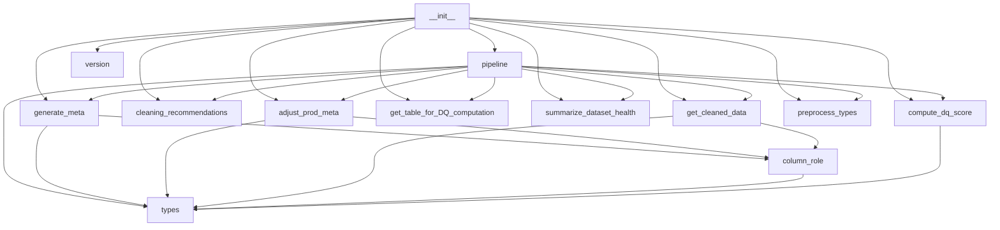
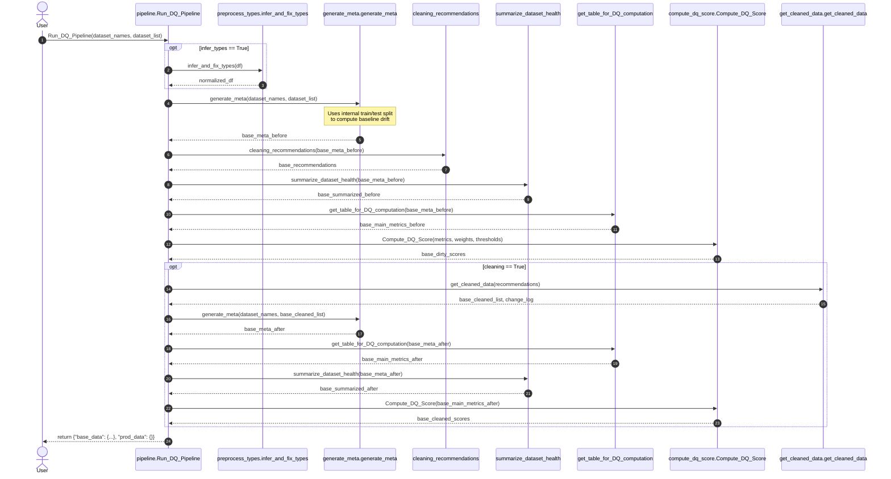
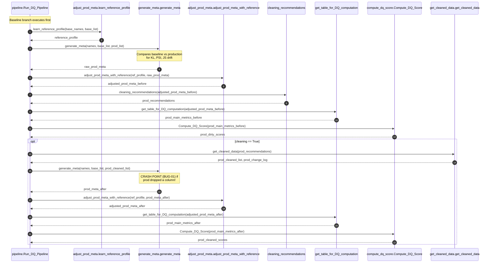

# Architecture Map & Module Dependency Analysis: Cleanalytix

**Library Location:** `C:\Users\Prabhat\Desktop\Carear\DQ_Framework\cleanalytix`  
**Audit Directory:** `C:\Users\Prabhat\Desktop\Carear\DQ_Framework\audit_reports`  
**Package Version:** `0.1.0` / `0.1.1`  

---

## 1. Codebase Directory & File Inventory

The `cleanalytix` package consists of 13 primary Python modules structured as a single-package root with no subpackages:

```
C:\Users\Prabhat\Desktop\Carear\DQ_Framework\cleanalytix\
|-- __init__.py                     # Package entry point and public symbol re-exports (311 lines)
|-- version.py                      # Package version and author metadata (12 lines)
|-- types.py                        # Typing protocols, TypedDicts, and type aliases (101 lines)
|-- column_role.py                  # Column-role heuristics (continuous, binary, id, etc.) (408 lines)
|-- preprocess_types.py             # Semantic type inference and coercive conversion (1,900 lines)
|-- generate_meta.py                # Profiling, entropy, type errors, drift (KL/PSI/JS) (1,027 lines)
|-- adjust_prod_meta.py             # Baseline reference learning & production outlier adjustment (239 lines)
|-- cleaning_recommendations.py     # Deterministic rule recommendation generator (204 lines)
|-- get_cleaned_data.py             # Data cleaning engine, Rule 1-11 implementations (768 lines)
|-- get_table_for_DQ_computation.py # Transforms raw metadata into scoring percentage metrics (116 lines)
|-- compute_dq_score.py             # Metric-to-score transformation & dataset DQ score aggregator (425 lines)
|-- summarize_dataset_health.py     # Aggregates column profile into high-level dataset health (73 lines)
`-- pipeline.py                     # Main orchestrator for Run_DQ_Pipeline (436 lines)
```

---

## 2. Module Responsibilities & Interface Specifications

| Module | Primary Responsibility | Key Public Functions / Classes | Inputs | Outputs |
|:---|:---|:---|:---|:---|
| `pipeline.py` | Orchestrates the entire profiling, scoring, cleaning, and monitoring pipeline. | `Run_DQ_Pipeline`, `run_dq_pipeline` | `dataset_names`, `dataset_list`, `new_dataset_list`, options | `DQPipelineResult` dict (`base_data`, `prod_data`) |
| `generate_meta.py` | Extracts complete column-level statistical metadata, entropy, errors, and drift. | `generate_meta`, `get_metrics`, `KL_PSI_and_JS`, `get_entropy`, `get_type_error_count`, `rule_based_errors` | DataFrames, names, rules | Column-level metadata `pd.DataFrame` (32 columns) |
| `column_role.py` | Assigns semantic roles to columns (`continuous`, `binary`, `identifier`, `categorical`, `datetime`). | `infer_column_role`, `is_identifier_column`, `is_binary_flag`, `harmonize_series_for_drift` | `pd.Series`, column name, row count | `ColumnRole` string |
| `preprocess_types.py` | Coercive type inference engine; normalizes dates, booleans, and numbers before profiling. | `infer_and_fix_types` | `pd.DataFrame` | Coerced `pd.DataFrame` |
| `cleaning_recommendations.py`| Maps metadata anomalies to ordered cleaning rule IDs (`1` through `10`). | `cleaning_recommendations` | `meta_data_combined` DataFrame | Recommendations `pd.DataFrame` |
| `get_cleaned_data.py` | Applies recommended cleaning rules (1–11), transforms values, logs changes. | `get_cleaned_data`, `clean`, `infer_semantic_type` | DataFrames, recommendations, rules | Cleaned DataFrames, `change_log` list/DataFrame |
| `adjust_prod_meta.py` | Learns baseline bounds and popular categories; adjusts production outlier/rare counts. | `learn_reference_profile`, `adjust_prod_meta_with_reference` | Baseline/Production DataFrames & metadata | Adjusted production metadata `pd.DataFrame` |
| `get_table_for_DQ_computation.py` | Converts raw metadata counts to scoring percentages, drops non-scored columns. | `get_table_for_DQ_computation` | Metadata DataFrame, DataFrames, names | Scoring metric DataFrame (12 columns) |
| `compute_dq_score.py` | Maps metric percentages to [0, 1] scores via linear or exponential decay and aggregates. | `Compute_DQ_Score`, `get_new_values`, `get_weights`, `resolve_thresholds` | Scoring table, DataFrames, weights, thresholds | Mapping `{dataset_name: dq_score}` |
| `summarize_dataset_health.py` | Produces compact dataset-level summary statistics. | `summarize_dataset_health` | Metadata DataFrame | Summary DataFrame (1 row per dataset) |
| `types.py` | Static type hints, Protocols, and TypedDicts. | `DQPipelineResult`, `PipelineBlock`, `ReferenceProfile`, etc. | N/A | Type annotations |
| `version.py` | Package version information. | `__version__`, `__author__` | N/A | Version strings |

---

## 3. Module Dependency Map

The diagram below maps all internal dependencies between modules:



### Import Health Assessment
- **Circular Imports:** None detected. The dependency tree is strictly acyclic.
- **Leaf Modules:** `types.py` and `version.py` have zero internal dependencies. `column_role.py` depends only on `types.py`.
- **Central Coupling:** `pipeline.py` is the universal consumer, depending on almost all modules.

---

## 4. End-to-End Pipeline Execution Flow

### 4.1 Baseline-Only Execution Flow



### 4.2 Production Monitoring Execution Flow



---

## 5. Artifact Schema & Data Flow Analysis

### 5.1 Metadata Schema (`generate_meta`)
Contains 32 columns generated per (dataset, column) pair:
- **Identification:** `dataset_name`, `column_name`, `column_role`, `dtype`
- **Completeness:** `non_null_count`, `missing_count`, `missing_percent`
- **Cardinality & Values:** `unique_count`, `unique_percent`, `mode`, `mode_percent`
- **Continuous Distribution:** `mean`, `std`, `skewness`, `skewness_level`, `min`, `max`, `median`, `outlier_count`
- **Categorical & Text:** `num_categories`, `rare_category_percent`, `whitespace_issues`
- **Temporal:** `min_date`, `max_date`, `date_range_days`
- **Information & Errors:** `Entropy`, `type_errors`, `rule_errors`
- **Dataset-Level:** `duplicate_rows_percent`
- **Drift:** `kl_divergence`, `psi_divergence`, `js_divergence`

### 5.2 Scorer Input Schema (`get_table_for_DQ_computation`)
Reduces the 32 columns down to 12 columns:
- `dataset_name`, `column_name` (Identifiers)
- `skewness`, `skewness_level` (Retained diagnostics, excluded from scoring)
- Scored metrics: `missing_percent`, `duplicate_rows_percent`, `psi_divergence`, `js_divergence`, `outlier_percent`, `whitespace_percent`, `rule_errors_percent`, `type_errors_percent`.

### 5.3 Recommendation Schema (`cleaning_recommendations`)
Rows correspond to (dataset, column) pairs:
- `dataset_name`, `column_name`
- `rule_ids` (List of ints, e.g. `[7, 4, 2, 3]`)
- `inferred_type` (`"numeric"`, `"datetime"`, `"categorical"`)
- `issue_names` (List of human-readable strings)
- `recommended_fix_order` (List of priority ints)

### 5.4 Cleaning Log Schema (`get_cleaned_data`)
Records atomic cleaning modifications:
- `dataset`, `column`, `rule_id`, `replacement`, `affected_rows`

---

## 6. Architectural Weaknesses & Antipatterns

1. **State Leakage via Positional Mismatch (BUG-01):**  
   `pipeline.py` maintains separate lists for base, base-cleaned, prod, and prod-cleaned data. When an operation drops a column in one branch, the schema divergence breaks downstream functions expecting parallel schemas.
2. **Double Transformation in Rule 7:**  
   Rule 7 violates the Single Responsibility Principle: it is titled "Type Errors", but it performs both type coercion AND automatic median/mode missing-value imputation.
3. **Leaky Heuristics Across Modules:**  
   `column_role.py` defines `infer_column_role`, but `get_cleaned_data.py` also defines `infer_semantic_type`, and `cleaning_recommendations.py` defines an internal `infer_type()` helper. Each uses slightly different heuristics and fallback behaviors.
4. **Unused Metric Overhead:**  
   Significant computation is dedicated to Shannon entropy and KL divergence, which are then dropped by `get_table_for_DQ_computation` without ever reaching the scorer.
