# Cleanalytix v0.2.0 — Complete Logical Architecture & Implementation Audit

**Repository Audited:** `C:\Users\Prabhat\Desktop\Carear\DQ_Framework\cleanalytix`  
**Version Audited:** `0.2.0` (Commit `ee7652e`)  
**Audit Type:** Independent End-to-End Logical, Mathematical, Statistical, and Architectural Verification  
**Audit Scope:** All 25 Python package modules (`8,632` lines of source code) and all 4 test modules (`1,683` lines of test code)

---

## A. Executive Verdict

### **Verdict: PARTIALLY SOUND — Architecturally Well-Structured, Visually Comprehensive, but Impaired by 22 Concrete Logical, Mathematical, and Cross-Module Integration Defects (3 Critical, 8 High, 8 Medium, 3 Low)**

Cleanalytix v0.2.0 represents a major architectural improvement over v0.1.0. Its separation of concerns into a 6-dimension Data Quality engine (`scoring.py`), a 10-domain analytical profiling layer (`profiling.py`), a standardized `MetricRegistry` (`registry.py`), a dedicated `metrics/` subpackage, and a dual-interface `CleanalytixResult` container (`types.py`) is clean and modular. Furthermore, several historical v0.1.0 flaws—such as baseline self-drift splitting, constant-baseline zero-division in PSI, population vs. sample variance (`ddof=1`), and unscaled dimension weight redistribution—were genuinely fixed.

However, **treating the implementation as the sole source of truth** and tracing every data path from `analyze()` and `Run_DQ_Pipeline()` through to the 10 analytical domains reveals that **the modules do not yet form a mathematically or logically unified system**. Multiple analytical domains compute the same metric using different denominators, different thresholds, different binning edge logic, or mismatched dictionary keys, and several core features silently fail or execute dead code paths:

1. **Silent Complete Failure of Continuous Drift Detection (PSI / KL / JSD = 0.0) on Point-Mass / 2-Unique-Value Numeric Baselines (`CRITICAL`, `AUD-001`):** In both `cleanalytix/metrics/drift.py` (`compute_numeric_drift`) and `cleanalytix/generate_meta.py` (`psi_kl_js`), when a numeric baseline has 90%+ ties such that `np.unique(np.percentile(b_arr, quantiles))` yields exactly 2 unique edges (e.g., `[10.0]*95 + [20.0]*5`), the code checks `if len(bin_edges) <= 1:` (which is `False` for length 2) and then overwrites `bin_edges[0] = -np.inf` and `bin_edges[-1] = np.inf`. This collapses the 2 edges into a **single `(-inf, +inf)` bin (`k = 1`)** containing 100% of both baseline and production observations. Consequently, even when production shifts from `10.0` to `1,000,000.0` (`KS = 1.0`), **PSI = `0.0`, KL = `0.0`, JSD = `0.0`, and the Stability dimension score is `100.0`**.
2. **100% Dead Code in Insight-Based Recommendation Generation (`CRITICAL`, `AUD-002`):** In `cleanalytix/cleaning_recommendations.py:239-240`, `generate_recommendations()` extracts `sev_str = ins.severity.value` from `InsightItem` objects and checks `if sev_str in {"CRITICAL", "WARNING"}:`. Because `InsightSeverity` (`types.py:31-35`) defines enum values in **lowercase** (`"critical"`, `"warning"`), this condition is **always `False`**. The entire recommendation synthesis loop for dataset-level and multidimensional insights (duplicate rows, identifier duplicates, cross-column consistency violations, timeliness staleness/future dates, and PSI drift) is dead code and never executes.
3. **`analyze(df, baseline_df=...)` Omits Reference Profile Adjustment and Duplicates Production Data into `base_data` (`CRITICAL`, `AUD-003`):** Unlike `Run_DQ_Pipeline`, `analyze()` never calls `learn_reference_profile()` or `adjust_prod_meta_with_reference()`. When production data shifts from `[10..12]` to `[1000..1002]`, `Run_DQ_Pipeline` detects 10 reference outliers (`100%`), whereas `analyze(prod_df, baseline_df=base_df)` evaluates `prod_df` against its own shifted IQR and reports **0 outliers**. Worse, `analyze()` populates both `result["base_data"]` and `result["prod_data"]` with the exact same `meta_df`, `overall_score`, and `health_summary` computed from `df`, never profiling `baseline_df` into `base_data`.
4. **Cross-Column Consistency Rules Crash on Nullable Types (`pd.NA`) and Penalize Missing Values as 100% Rule Violations (`HIGH`, `AUD-004`):** In `scoring.py:262`, `_evaluate_consistency_rules` converts rule outputs via `np.asarray(res, dtype=bool)`. When `infer_types=True` (the default in `analyze()`), numeric/boolean columns with missing values are converted to pandas nullable types (`Int64`, `Float64`, `boolean`). Relational comparisons (`df["a"] > df["b"]`) on nullable series return a `boolean` series containing `pd.NA`. Calling `np.asarray(res, dtype=bool)` on `pd.NA` raises `ValueError: cannot convert to 'bool'-dtype NumPy array with missing values`, which the `except Exception` block catches and converts into **`violation_percent = 100.0` and `Consistency score = 0.0`**.
5. **Column-Level `rule_based_errors` Evaluates `NaN`/`None` Values, Double-Penalizing Missing Data in Both Completeness and Validity (`HIGH`, `AUD-005`):** In `generate_meta.py:184-201`, `rule_based_errors()` iterates `for val in df[column]:` without skipping nulls (`pd.isna(val)`). Standard predicates such as `lambda x: x >= 0` or `lambda x: 0 <= x <= 120` evaluate to `False` on `np.nan` (or raise `TypeError` on `None`, which is caught and counted as a rule error). Thus every missing value in a rule-validated column is penalized twice: once in Completeness and again in Validity.
6. **Systematic Denominator Mismatch (`non_null_count` vs. `total_rows`) Across Scoring, Profiling, Metric Inventory, and Insights (`HIGH`, `AUD-006`):** `MetricRegistry` (`registry.py`), `build_column_profile` (`profiling.py`), and `build_metric_inventory` (`scoring.py`) divide `type_errors`, `whitespace_issues`, and `rule_errors` by `non_null_count`. However, `score_dataset` (`scoring.py`), `generate_dataset_insights` (`insights.py`), `generate_recommendations` (`cleaning_recommendations.py`), and `get_table_for_DQ_computation` divide the exact same counts by `total_rows` (`non_null_count + missing_count`). On columns with missing values, `metric_inventory` and `column_profile` display different error percentages and different `metric_score` values than the actual Validity score used in `quality_dimensions["validity"]` and `scoring_matrix`.
7. **Timeliness Multi-Column Subscore Overwrite, Broken `metric_inventory` Lookup, and Exclusion from Column Quality Scores (`HIGH`, `AUD-007`):** In `_evaluate_timeliness` (`scoring.py:368-425`), per-column metrics are stored with column prefixes (`f"{c}_freshness_days"`), but `build_metric_inventory` (`scoring.py:1240`) looks up the unprefixed key `time_ds.metrics.get("freshness_days")`, which **always returns `None`**. As a result, `timeliness_freshness` in `metric_inventory` always displays `raw_value = NaN` and `status = "PASS"` even when the dataset is 5 years stale. Moreover, `metric_subscores["freshness_score"]` is set outside the `for c in dt_cols:` loop using the loop-local variable `s_fresh` from the **last** datetime column only, and datetime staleness/future dates are never included in `col_scores_collector[col]` (leaving 100% stale datetime columns with `column_quality_score = 100.0`).
8. **Naive Substring Matching in `compute_identifier_uniqueness` Treats Normal Columns (`"width"`, `"paid"`, `"valid"`, `"country_code"`) as Primary Keys (`HIGH`, `AUD-008`):** While `column_role.py` uses a word-boundary regex `_ID_NAME_PATTERN`, `uniqueness.py:233` uses `any(k in str(c).lower() for k in ["_id", "id", "uuid", "guid", "pk", "key", "code"])`. Any column whose name contains the substring `"id"`, `"key"`, or `"code"`—such as `"width"`, `"paid"`, `"valid"`, `"video"`, `"monkey"`, `"country_code"`, or `"status_code"`—is evaluated as a primary identifier requiring 100% unique values, severely penalizing the dataset's Uniqueness score whenever repeated values occur.

---

## B. Architecture Map

### 1. Module Inventory & Responsibility Breakdown

| Module Path | Lines | Architectural Role & Primary Functions |
| :--- | :---: | :--- |
| `cleanalytix/__init__.py` | 111 | Public package facade (`analyze`, `Run_DQ_Pipeline`, `generate_meta`, `compute_dq_score`, `MetricRegistry`, etc.). |
| `cleanalytix/version.py` | 12 | Single-source version constant (`__version__ = "0.2.0"`). |
| `cleanalytix/types.py` | 673 | Core data models (`CleanalytixConfig`, `CleanalytixResult`, `DimensionScore`, `DatasetProfile`, `InsightItem`, `RecommendationItem`, `ConsistencyRule`, `TimelinessConfig`, `QualityDimension`). |
| `cleanalytix/pipeline.py` | 390 | Orchestration entry points: `analyze()` (modern 10-domain pipeline) and `Run_DQ_Pipeline()` (legacy multi-dataset dictionary pipeline). |
| `cleanalytix/preprocess_types.py` | 1,961 | Heuristic type inference and normalization (`infer_and_fix_types`), numeric/boolean/datetime/categorical coercion, currency/unit/percentage parsing. |
| `cleanalytix/column_role.py` | 167 | Semantic role classification (`infer_column_role`, `is_identifier_column`, `is_binary_series`, `is_free_text_series`). |
| `cleanalytix/generate_meta.py` | 607 | Per-column metadata extraction (`generate_meta`), type error counting (`get_type_error_count`), rule error counting (`rule_based_errors`), outlier & distribution metrics (`numeric_stats_and_outliers`), and drift computation (`psi_kl_js`). |
| `cleanalytix/adjust_prod_meta.py` | 159 | Reference profile learning (`learn_reference_profile`) and baseline-anchored production outlier/rare-category adjustment (`adjust_prod_meta_with_reference`). |
| `cleanalytix/scoring.py` | 1,321 | Six-dimension DQ scoring engine (`score_dataset`), Consistency/Timeliness evaluators, scoring audit trail (`build_scoring_audit_trail`), per-column scoring matrix (`build_scoring_matrix`), and metric inventory (`build_metric_inventory`). |
| `cleanalytix/profiling.py` | 785 | Analytical domain builders: `build_dataset_profile`, `build_column_profile`, `build_statistical_profile`, `build_relationship_profile`, `build_drift_profile`, `build_temporal_profile`, `build_anomaly_diagnostics`. |
| `cleanalytix/registry.py` | 816 | Standardized catalog of 51 metrics (`MetricRegistry`, `MetricDefinition`) across 9 analytical domains. |
| `cleanalytix/insights.py` | 373 | Diagnostic insight generator (`generate_dataset_insights`) producing severity-ranked `InsightItem` records. |
| `cleanalytix/cleaning_recommendations.py` | 465 | Actionable remediation engine (`generate_recommendations` for modern API, `cleaning_recommendations` for legacy table). |
| `cleanalytix/compute_dq_score.py` | 158 | Legacy flat 8-metric weighted DQ score computation (`compute_dq_score`, `get_new_values`, `resolve_weights`). |
| `cleanalytix/get_table_for_DQ_computation.py` | 80 | Legacy dataset-level aggregation of column metadata into flat error percentages (`get_table_for_DQ_computation`). |
| `cleanalytix/summarize_dataset_health.py` | 53 | Legacy health summary aggregator (`summarize_dataset_health`). |
| `cleanalytix/get_cleaned_data.py` | 90 | Retired automated mutation stubs (`get_cleaned_data`, `clean`) raising `FeatureRetiredError`. |
| `cleanalytix/metrics/completeness.py` | 112 | Cell/row/column completeness and missingness co-occurrence (`compute_completeness_metrics`). |
| `cleanalytix/metrics/uniqueness.py` | 282 | Column uniqueness, duplicate row counts, candidate key discovery, identifier uniqueness (`compute_identifier_uniqueness`). |
| `cleanalytix/metrics/statistical.py` | 256 | Moments, quantiles, IQR/MAD/CV, normality tests, multi-method outlier detection (`compute_numeric_statistics`, `detect_outliers`). |
| `cleanalytix/metrics/distribution.py` | 204 | Categorical entropy, Gini impurity, HHI, rare categories, modality detection (`compute_categorical_distribution`, `detect_modality`). |
| `cleanalytix/metrics/drift.py` | 269 | Numeric and categorical drift metrics: KS, Wasserstein, PSI, KL, Reverse KL, JSD, Chi-square, TVD (`compute_numeric_drift`, `compute_categorical_drift`). |
| `cleanalytix/metrics/relationships.py` | 190 | Pearson/Spearman correlations, VIF, Cramér's V, duplicate column detection (`compute_numeric_correlations`, `compute_cramers_v`). |
| `cleanalytix/metrics/temporal.py` | 120 | Datetime range, freshness, future dates, monotonicity, cadence inference, gap detection (`compute_temporal_metrics`). |

---

### 2. End-to-End Execution Flow & Dual-Pipeline Divergence

```mermaid
flowchart TD
    subgraph Modern_API ["Modern Entry Point: analyze(df, baseline_df, config)"]
        A1["Input Validation & Deep Copy (df, baseline_df)"] --> A2["Optional Type Inference: infer_and_fix_types(work_df)"]
        A2 --> A3["Metadata Profiling: generate_meta([name], [base], [prod])"]
        A3 --> A4["6-Dimension Scoring: score_dataset(work_df, meta_df, baseline_df, config)"]
        A4 --> A5["Insights & Recommendations: generate_dataset_insights() -> generate_recommendations()"]
        A5 --> A6["10-Domain Analytical Builders (profiling.py & scoring.py)"]
        A6 --> A7["CleanalytixResult Assembly (types.py)"]
    end

    subgraph Legacy_API ["Legacy Entry Point: Run_DQ_Pipeline(names, base_list, prod_list)"]
        L1["Input Validation & Copy"] --> L2["Optional Type Inference: infer_and_fix_types()"]
        L2 --> L3["Baseline Metadata: generate_meta(names, base_list)"]
        L3 --> L4["Baseline Scoring: score_dataset() per dataset"]
        L4 --> L5["Reference Learning: learn_reference_profile(base_list, base_meta)"]
        L5 --> L6["Prod Metadata: generate_meta(names, base_list, prod_list)"]
        L6 --> L7["Reference Adjustment: adjust_prod_meta_with_reference(prod_meta, prod_list, ref_prof)"]
        L7 --> L8["Prod Scoring: score_dataset() per dataset"]
    end
```



> [!CAUTION]
> **Critical Architectural Split:** The repository maintains **two parallel calculation stacks** that do not share single-source intermediate results:
> 1. `generate_meta.py` computes its own missingness, uniqueness, skewness, entropy, rare categories, outliers, and PSI/KL/JSD into `meta_df`, which drives `score_dataset()`, `generate_dataset_insights()`, and `generate_recommendations()`.
> 2. `profiling.py` re-computes completeness, uniqueness, statistical moments, categorical distributions, outliers, temporal metrics, and drift from scratch using `cleanalytix/metrics/*` to populate `dataset_profile`, `column_profile`, `statistical_profile`, `temporal_profile`, `drift_profile`, and `anomaly_records`.
>
> Because these two stacks use subtly different formulas, thresholds, and column-role filters, **the numbers used to score the dataset in `score_dataset()` frequently disagree with the numbers displayed in the analytical profile tables**.

---

## C. Detailed Findings (Code-Verified & Empirically Reproduced)

---

### `AUD-001` — Continuous PSI, KL, and JSD Collapse to `0.0` When Numeric Baseline Quantiles Produce Exactly Two Unique Bin Edges

- **Severity:** `CRITICAL`
- **Locations:**
  - [drift.py](file:///c:/Users/Prabhat/Desktop/Carear/DQ_Framework/cleanalytix/metrics/drift.py#L102-L119) (`compute_numeric_drift`)
  - [generate_meta.py](file:///c:/Users/Prabhat/Desktop/Carear/DQ_Framework/cleanalytix/generate_meta.py#L292-L309) (`psi_kl_js`)
- **Current Implementation Behavior:**
  ```python
  quantiles = np.linspace(0, 100, bins + 1)
  bin_edges = np.percentile(b_arr, quantiles)
  bin_edges = np.unique(bin_edges)

  if len(bin_edges) <= 1:
      # Constant baseline fallback (3-bin surrogate)
      ...
  else:
      bin_edges[0] = -np.inf
      bin_edges[-1] = np.inf
      b_counts, _ = np.histogram(b_arr, bins=bin_edges)
      p_counts, _ = np.histogram(p_arr, bins=bin_edges)
  ```
- **Why It Is Mathematically and Logically Incorrect:**
  A histogram with $k$ bins requires $k + 1$ edges. When a baseline numeric column has point masses (for example, 90% of values are `10.0` and 10% are `20.0`, or a zero-inflated numeric feature where 95% of values are `0.0` and 5% are `50.0`), `np.percentile(b_arr, [0, 10, ..., 100])` produces `[10.0, 10.0, ..., 10.0, 20.0]`. Calling `np.unique(bin_edges)` yields an array of length **2**: `[10.0, 20.0]`.
  Because `len(bin_edges)` is `2`, `if len(bin_edges) <= 1:` is `False`. The `else` branch then overwrites:
  - `bin_edges[0] = -np.inf`
  - `bin_edges[-1] = np.inf`
  This turns `bin_edges` into `[-np.inf, np.inf]`—**a single bin covering $(-\infty, +\infty)$**!
  Both `b_arr` and `p_arr` place 100% of their finite observations into that single bin (`p_b = [1.0]`, `p_p = [1.0]`), resulting in:
  $$\text{PSI} = 0.0, \quad D_{\text{KL}} = 0.0, \quad \text{JSD} = 0.0$$
  regardless of how catastrophically the production distribution shifts.
- **Concrete Reproduction Scenario:**
  ```python
  base_df = pd.DataFrame({"x": [10.0] * 95 + [20.0] * 5})
  prod_df = pd.DataFrame({"x": [1000000.0] * 100})
  res = cx.analyze(prod_df, baseline_df=base_df)
  ```
- **Expected vs. Actual Behavior:**
  - **Expected:** Extreme drift detected ($\text{PSI} \gg 0.25$, $\text{JSD} \approx \ln 2$ or $1.0$, Stability score $= 0.0$).
  - **Actual:** `res.metadata["psi_divergence"].iloc[0] == 0.0`, `kl_divergence == 0.0`, `js_divergence == 0.0`, `res.drift_profile["psi"].iloc[0] == 0.0`, and **`res.quality_dimensions["stability"].score == 100.0`**!
- **Recommended Correction:**
  When `len(bin_edges) == 2` (say $[e_0, e_1]$ with $e_0 < e_1$), construct interior split boundaries rather than overwriting the only two edges with $\pm\infty$, e.g., `bin_edges = np.array([-np.inf, e0, (e0 + e1) / 2.0, e1, np.inf])`, or preserve interior edges via `bin_edges = np.concatenate(([-np.inf], bin_edges, [np.inf]))` when `len(bin_edges) <= 3`.

---

### `AUD-002` — Case Mismatch Between `InsightSeverity` Enum Values and `generate_recommendations()` Filter Renders Multidimensional Recommendations 100% Dead Code

- **Severity:** `CRITICAL`
- **Locations:**
  - [cleaning_recommendations.py](file:///c:/Users/Prabhat/Desktop/Carear/DQ_Framework/cleanalytix/cleaning_recommendations.py#L237-L260) (`generate_recommendations`)
  - [types.py](file:///c:/Users/Prabhat/Desktop/Carear/DQ_Framework/cleanalytix/types.py#L31-L36) (`InsightSeverity`)
- **Current Implementation Behavior:**
  In `types.py:31-35`:
  ```python
  class InsightSeverity(str, Enum):
      CRITICAL = "critical"
      WARNING = "warning"
      INFO = "info"
      OPTIMIZATION = "optimization"
  ```
  In `cleaning_recommendations.py:238-240`:
  ```python
  for ins in insights:
      sev_str = ins.severity.value if isinstance(ins.severity, InsightSeverity) else str(ins.severity)
      if sev_str in {"CRITICAL", "WARNING"}:
          # Generates recommendations for Uniqueness, Consistency, Timeliness, Stability...
  ```
- **Why It Is Logically Incorrect:**
  `ins.severity.value` is always `"critical"` or `"warning"` (lowercase), whereas the set check tests membership in `{"CRITICAL", "WARNING"}` (uppercase). Therefore, `if sev_str in {"CRITICAL", "WARNING"}:` is **unconditionally `False`**.
  Because column-level Completeness and Validity recommendations are generated in a separate loop (`lines 262-415`) while Uniqueness (duplicate rows, duplicate identifiers), Consistency (cross-column rule violations), Timeliness (staleness, future dates, sequence violations), and Stability (PSI drift) recommendations rely exclusively on this `insights` loop (`lines 237-260`), **Cleanalytix v0.2.0 never emits any recommendations for Uniqueness, Consistency, Timeliness, or Stability**.
- **Concrete Reproduction Scenario:**
  ```python
  df = pd.DataFrame({"a": [1, 1, 1, 1, 2], "b": [10, 10, 10, 10, 20]})
  cfg = cx.CleanalytixConfig(consistency_rules=[ConsistencyRule(name="r1", condition=lambda d: d["a"] > d["b"])])
  res = cx.analyze(df, config=cfg)
  ```
- **Expected vs. Actual Behavior:**
  - **Expected:** `res.recommendations` includes high-priority recommendations to deduplicate the 60% duplicate rows (`UNIQUENESS`) and remediate the 100% cross-column rule violations (`CONSISTENCY`).
  - **Actual:** `res.insights` contains both `critical` insights, but `res.recommendations` contains **zero** `uniqueness` or `consistency` recommendations (only column-level outlier/skewness recommendations).
- **Recommended Correction:**
  Normalize case before checking: `sev_str = (ins.severity.value if isinstance(ins.severity, InsightSeverity) else str(ins.severity)).upper()`.

---

### `AUD-003` — `analyze(df, baseline_df=...)` Omits Baseline Reference Adjustment (`adjust_prod_meta_with_reference`) and Copies Production Results into `base_data`

- **Severity:** `CRITICAL`
- **Locations:**
  - [pipeline.py](file:///c:/Users/Prabhat/Desktop/Carear/DQ_Framework/cleanalytix/pipeline.py#L112-L212) (`analyze`)
  - Compare with [pipeline.py](file:///c:/Users/Prabhat/Desktop/Carear/DQ_Framework/cleanalytix/pipeline.py#L351-L362) (`Run_DQ_Pipeline`)
- **Current Implementation Behavior:**
  In `analyze()`:
  1. Line 120 calls `meta_df = generate_meta(dataset_names=[dataset_name], dataset_list=[work_base], new_dataset_list=[work_df], rules=active_rules)` when `work_base is not None`.
  2. Inside `generate_meta` (`generate_meta.py:518`), `profile_list = new_dataset_list if new_dataset_list is not None else dataset_list`, so `meta_df` profiles `work_df` using `work_df`'s own mean, standard deviation, IQR bounds, and category frequencies.
  3. Unlike `Run_DQ_Pipeline` (lines 351–361), `analyze()` **never calls** `learn_reference_profile([work_base], base_meta)` or `adjust_prod_meta_with_reference(meta_df, [work_df], ref_profile)`.
  4. Then, at lines 193–211 of `pipeline.py`, `analyze()` populates `base_data_block` and `prod_data_block` using the **exact same** `score_df`, `meta_df`, `health_df`, and `main_metrics_df` from `work_df`!
- **Why It Is Logically Incorrect:**
  1. When a production batch experiences a location shift (e.g., all sensor readings shift from `[10, 12]` to `[1000, 1002]`), evaluating outliers against production's own IQR finds 0 outliers. Reference-based outlier and rare-category detection (`adjust_prod_meta.py`) was specifically designed for this purpose and is used in `Run_DQ_Pipeline`, but was omitted from `analyze()`.
  2. When a caller inspects `res["base_data"]` and `res["prod_data"]` on the `CleanalytixResult` returned by `analyze(prod_df, baseline_df=base_df)`, `res["base_data"]` does not contain the baseline dataset's metadata or score—it contains a duplicate copy of `prod_df`'s metadata and score.
- **Concrete Reproduction Scenario:**
  ```python
  base_ref = pd.DataFrame({"val": [10.0, 11.0, 12.0, 10.5, 11.5, 10.2, 11.8, 10.9, 11.1, 10.7]})
  prod_shifted = pd.DataFrame({"val": [1000.0, 1001.0, 1002.0, 1000.5, 1001.5, 1000.2, 1001.8, 1000.9, 1001.1, 1000.7]})
  res_analyze = cx.analyze(prod_shifted, baseline_df=base_ref)
  res_pipeline = cx.Run_DQ_Pipeline(["ds"], [base_ref], [prod_shifted])
  ```
- **Expected vs. Actual Behavior:**
  - **Expected:** Both entry points detect 10 reference outliers in `prod_shifted`, and `res_analyze["base_data"]` reflects `base_ref` (`DQ_Score = 100.0`) while `res_analyze["prod_data"]` reflects `prod_shifted`.
  - **Actual:** `Run_DQ_Pipeline` detects `outlier_count = 10`, whereas `analyze()` detects `outlier_count = 0`. Furthermore, `res_analyze["base_data"]["dirty_scores"]` and `res_analyze["prod_data"]["dirty_scores"]` both report `78.57` (the production score).
- **Recommended Correction:**
  In `analyze()`, when `work_base is not None`, profile `base_meta = generate_meta([dataset_name], [work_base], rules=active_rules)`, learn `ref_prof = learn_reference_profile([work_base], base_meta)`, adjust `meta_df = adjust_prod_meta_with_reference(meta_df, [work_df], ref_prof)`, and populate `base_data_block` using `base_meta` and baseline scores.

---

### `AUD-004` — `_evaluate_consistency_rules` Crashes on Nullable Pandas Extension Types (`pd.NA`) and Treats Missing Values as Consistency Violations

- **Severity:** `HIGH`
- **Location:** [scoring.py](file:///c:/Users/Prabhat/Desktop/Carear/DQ_Framework/cleanalytix/scoring.py#L259-L286) (`_evaluate_consistency_rules`)
- **Current Implementation Behavior:**
  ```python
  try:
      res = cond_fn(df)
      if isinstance(res, (pd.Series, np.ndarray, list)):
          res_arr = np.asarray(res, dtype=bool)
          valid_count = int(np.sum(res_arr))
          violation_count = max(0, total_rows - valid_count)
  ...
  except Exception as ex:
      # Rule execution failure treats evaluated rule as violated
      rule_scores.append(0.0)
      rule_details[name] = {
          "error": str(ex),
          "violations": total_rows,
          "violation_percent": 100.0,
          "score": 0.0,
      }
  ```
- **Why It Is Logically Incorrect:**
  1. When `analyze(df)` runs with default `infer_types=True`, `infer_and_fix_types()` converts integer, float, and boolean columns containing nulls into pandas nullable extension types (`Int64`, `Float64`, `boolean`).
  2. Any vector relational expression on nullable columns (e.g., `lambda d: d["a"] > d["b"]`) returns a pandas `Series` of nullable `boolean` dtype containing `pd.NA` wherever `a` or `b` is missing.
  3. Calling `np.asarray(res, dtype=bool)` on a series containing `pd.NA` raises `ValueError: cannot convert to 'bool'-dtype NumPy array with missing values. Specify an appropriate 'na_value' for this dtype.`
  4. The `except Exception` block catches this `ValueError` and marks **100% of rows in the dataset as rule violations (`score = 0.0`)**!
  5. Even for standard `float64` columns with `np.nan`, `d["a"] > d["b"]` evaluates to `False` on `np.nan`, so missing values are counted as cross-column consistency violations (double-penalizing Completeness and Consistency).
- **Concrete Reproduction Scenario:**
  ```python
  df = pd.DataFrame({
      "a": pd.Series([10, 20, 30, 40, None], dtype="Int64"),
      "b": pd.Series([5, 10, 15, 20, 25], dtype="Int64"),
  })
  cfg = cx.CleanalytixConfig(consistency_rules=[ConsistencyRule(name="a_gt_b", condition=lambda d: d["a"] > d["b"])])
  res = cx.analyze(df, config=cfg)
  ```
- **Expected vs. Actual Behavior:**
  - **Expected:** All 4 non-null rows satisfy `a > b` (`10>5`, `20>10`, `30>15`, `40>20`); the 1 null row is exempt from consistency rule evaluation (0 violations, Consistency score `100.0`).
  - **Actual:** `res.quality_dimensions["consistency"].score == 0.0` with `violations: 5, violation_percent: 100.0` due to the caught `ValueError`.
- **Recommended Correction:**
  Convert `res` via `s = pd.Series(res)` and treat `pd.NA`/`np.nan` in the resulting mask (or rows where referenced columns are null) by filling `na_value=True` (`valid_mask = s.fillna(True).astype(bool)`) before counting violations, or evaluate `violation_pct` over non-NA rule outcomes.

---

### `AUD-005` — `rule_based_errors` Evaluates `NaN`/`None` Values Against Column Rules, Double-Penalizing Missing Data in Completeness and Validity

- **Severity:** `HIGH`
- **Location:** [generate_meta.py](file:///c:/Users/Prabhat/Desktop/Carear/DQ_Framework/cleanalytix/generate_meta.py#L184-L201) (`rule_based_errors`)
- **Current Implementation Behavior:**
  ```python
  def rule_based_errors(df: pd.DataFrame, column: str, rules: Optional[ Mapping[str, Any] ] = None) -> int:
      if not rules or column not in rules:
          return 0
      rule_fn = rules[column]
      if not callable(rule_fn):
          return 0
      errors = 0
      for val in df[column]:
          try:
              if not bool(rule_fn(val)):
                  errors += 1
          except Exception:
              errors += 1
      return errors
  ```
- **Why It Is Logically Incorrect:**
  Missing values (`None`, `np.nan`, `pd.NA`, `pd.NaT`) represent absence of data (**Completeness**), not invalid domain values (**Validity**). Because `rule_based_errors` does not skip `pd.isna(val)`, any standard domain rule such as `rules={"age": lambda x: 0 <= x <= 120}` evaluates `0 <= np.nan <= 120` (which is `False` in Python) or `0 <= None <= 120` (which raises `TypeError` and is caught as an error). Thus, every missing value increments `rule_errors` by 1.
  Notice that in `tests/test_pipeline.py:25-27`, the test author had to manually write `if pd.isna(value): return True` inside `_valid_age` to work around this flaw, whereas users passing standard lambdas (`lambda x: x >= 0`) suffer silent double-penalization.
- **Concrete Reproduction Scenario:**
  ```python
  df = pd.DataFrame({"age": [25.0, 30.0, None, None, None]})
  res = cx.analyze(df, rules={"age": lambda x: x >= 0})
  ```
- **Expected vs. Actual Behavior:**
  - **Expected:** `rule_errors = 0` (all non-null ages `25.0` and `30.0` are $\ge 0$); Validity score $= 100.0$; Completeness score $= 0.0$.
  - **Actual:** `rule_errors = 3` (`60%` rule error rate); Validity score drops to `50.0` alongside Completeness score `0.0`.
- **Recommended Correction:**
  Skip missing values at the start of the loop in `rule_based_errors`:
  ```python
  for val in df[column]:
      if pd.isna(val):
          continue
  ```

---

### `AUD-006` — Denominator Inconsistency (`non_null_count` vs. `total_rows`) Between Scoring Engine, Column Profile, Metric Inventory, and Insights

- **Severity:** `HIGH`
- **Locations:**
  - `total_rows` denominator used in:
    - [scoring.py](file:///c:/Users/Prabhat/Desktop/Carear/DQ_Framework/cleanalytix/scoring.py#L571-L610) (`score_dataset`)
    - [insights.py](file:///c:/Users/Prabhat/Desktop/Carear/DQ_Framework/cleanalytix/insights.py#L217-L264) (`generate_dataset_insights`)
    - [cleaning_recommendations.py](file:///c:/Users/Prabhat/Desktop/Carear/DQ_Framework/cleanalytix/cleaning_recommendations.py#L269-L293) (`generate_recommendations`)
    - [get_table_for_DQ_computation.py](file:///c:/Users/Prabhat/Desktop/Carear/DQ_Framework/cleanalytix/get_table_for_DQ_computation.py#L55-L67) (`get_table_for_DQ_computation`)
  - `non_null_count` denominator used in:
    - [registry.py](file:///c:/Users/Prabhat/Desktop/Carear/DQ_Framework/cleanalytix/registry.py#L190-L220) (`MetricRegistry` definitions for `validity_type_errors`, `validity_whitespace`, `validity_rules`)
    - [profiling.py](file:///c:/Users/Prabhat/Desktop/Carear/DQ_Framework/cleanalytix/profiling.py#L234-L240) (`build_column_profile`)
    - [scoring.py](file:///c:/Users/Prabhat/Desktop/Carear/DQ_Framework/cleanalytix/scoring.py#L1116-L1140) (`build_metric_inventory`)
- **Current Implementation Behavior:**
  - In `score_dataset` (`scoring.py:591`): `ws_pct = (ws_err / total_rows) * 100.0` (and similarly for `type_pct` and `rule_pct`).
  - In `build_metric_inventory` (`scoring.py:1138`) and `build_column_profile` (`profiling.py:236`): `ws_pct = 100.0 * (ws_err / non_null)`.
- **Why It Is Mathematically and Logically Incorrect:**
  1. Mathematically, Validity measures the conformance of **present (non-null)** values; dividing by `total_rows` artificially dilutes the Validity error rate whenever a column has high missingness (for example, if 90 rows are null and 5 of the 10 non-null rows have type errors, `50%` of present values are invalid, but dividing by `total_rows` reports only `5%`).
  2. Architecturally, using `non_null_count` in `metric_inventory` and `column_profile` while using `total_rows` in `score_dataset` causes **`metric_inventory` to report a different `metric_score` than the score actually used by `score_dataset`**.
- **Concrete Reproduction Scenario:**
  ```python
  df = pd.DataFrame({"code": [" A "] + ["B"] * 49 + [None] * 50})
  res = cx.analyze(df)
  ```
- **Expected vs. Actual Behavior:**
  - **Expected:** `column_profile`, `metric_inventory`, `score_dataset`, and `insights` all use the same denominator (`non_null_count = 50`, so `whitespace_percent = 2.0%` and `ws_score = 60.0` across all outputs).
  - **Actual:**
    - `res.column_profile.loc["code", "whitespace_percent"]` is **`2.0%`**.
    - `res.metric_inventory` reports `raw_value = 2.0` and `metric_score = 60.0`.
    - `score_dataset` computes `ws_pct = 1.0%` (`1 / 100`), scoring whitespace at **`80.0`** instead of `60.0`, producing a Validity dimension score of **`93.33`** instead of **`86.67`**.
- **Recommended Correction:**
  Standardize on `max(1, non_null_count)` as the denominator for column-level Validity error rates (`type_errors`, `whitespace_issues`, `rule_errors`, `outlier_count`) across `scoring.py`, `insights.py`, `cleaning_recommendations.py`, `profiling.py`, and `get_table_for_DQ_computation.py`.

---

### `AUD-007` — Multi-Column Timeliness Subscore Overwrite, Broken `metric_inventory` Unprefixed Key Lookup, and Omission from Column Quality Scores

- **Severity:** `HIGH`
- **Locations:**
  - [scoring.py](file:///c:/Users/Prabhat/Desktop/Carear/DQ_Framework/cleanalytix/scoring.py#L368-L432) (`_evaluate_timeliness`)
  - [scoring.py](file:///c:/Users/Prabhat/Desktop/Carear/DQ_Framework/cleanalytix/scoring.py#L890-L910) (`score_dataset` column score aggregation)
  - [scoring.py](file:///c:/Users/Prabhat/Desktop/Carear/DQ_Framework/cleanalytix/scoring.py#L1239-L1257) (`build_metric_inventory`)
- **Current Implementation Behavior:**
  1. In `_evaluate_timeliness` (`scoring.py:368-425`), the loop `for c in dt_cols:` computes loop-local variables `s_fresh`, `s_future`, `s_seq` and stores column-prefixed keys in `all_metrics`:
     ```python
     all_metrics[f"{c}_freshness_days"] = round(actual_fresh, 2)
     all_metrics[f"{c}_future_dates_percent"] = round(fut_pct, 4)
     ```
     Then, **outside** the loop (`lines 422-424`), it writes:
     ```python
     metric_subscores["freshness_score"] = round(s_fresh * 100.0, 2)
     metric_subscores["future_dates_score"] = round(s_future * 100.0, 2)
     if require_monotonic:
         metric_subscores["sequence_score"] = round(s_seq * 100.0, 2)
     ```
     This uses the values of `s_fresh`, `s_future`, and `s_seq` from the **final iteration of the loop only**!
  2. In `build_metric_inventory` (`scoring.py:1240-1251`), it looks up:
     ```python
     fresh_days = time_ds.metrics.get("freshness_days")
     ...
     "raw_value": round(float(fresh_days), 2) if fresh_days is not None else None,
     "status": "PASS" if (fresh_days or 0) <= thresholds.get("freshness_days", 30.0) else "WARNING",
     ```
     Because `time_ds.metrics` only contains `{col}_freshness_days` (never `"freshness_days"`), `fresh_days` is **always `None`**, `(fresh_days or 0)` is **always `0`**, and `status` is **always `"PASS"`**! Furthermore, `timeliness_future_dates` and `timeliness_sequence` are completely omitted from `metric_inventory`.
  3. In `score_dataset`, `_evaluate_timeliness` never contributes to `col_scores_collector[col]` or `per_col_subscores[col]`.
- **Concrete Reproduction Scenario:**
  ```python
  df_time = pd.DataFrame({
      "stale_dt": pd.to_datetime(["2020-01-01", "2020-01-02", "2020-01-03"]),
      "fresh_dt": pd.to_datetime(["2025-01-01", "2025-01-02", "2025-01-03"]),
  })
  cfg = cx.CleanalytixConfig(timeliness_config=TimelinessConfig(reference_time="2025-01-03", freshness_days=30.0))
  res = cx.analyze(df_time, config=cfg)
  ```
- **Expected vs. Actual Behavior:**
  - **Expected:** `stale_dt` is 1,827 days stale (`freshness_score = 0.0` for `stale_dt`, `100.0` for `fresh_dt`, mean `freshness_score = 50.0`); `metric_inventory` reports per-column freshness rows (showing `1827.0` days and `WARNING` for `stale_dt`); `stale_dt` gets `column_quality_score < 100.0`.
  - **Actual:**
    - `res.quality_dimensions["timeliness"].score == 75.0`, yet `res.quality_dimensions["timeliness"].metric_scores` is `{'freshness_score': 100.0, 'future_dates_score': 100.0, 'sequence_score': 100.0}` (all 100.0!).
    - `res.metric_inventory` for `timeliness_freshness` has `raw_value: NaN`, `status: 'PASS'`, `metric_score: 100.0`.
    - `res.column_profile.loc["stale_dt", "column_quality_score"] == 100.0`.
- **Recommended Correction:**
  Collect per-column `s_fresh`, `s_future`, and `s_seq` lists across `dt_cols` and store their means in `metric_subscores`; emit per-column rows in `build_metric_inventory` for `timeliness_freshness`, `timeliness_future_dates`, and `timeliness_sequence`; and append per-column timeliness scores to `col_scores_collector[c]`.

---

### `AUD-008` — Substring Matching in `compute_identifier_uniqueness` Treats Normal Columns (`"width"`, `"paid"`, `"valid"`, `"country_code"`) as Primary Keys

- **Severity:** `HIGH`
- **Location:** [uniqueness.py](file:///c:/Users/Prabhat/Desktop/Carear/DQ_Framework/cleanalytix/metrics/uniqueness.py#L228-L236) (`compute_identifier_uniqueness`)
- **Current Implementation Behavior:**
  ```python
  if id_columns is None:
      id_cols = [
          str(c) for c in df.columns
          if any(k in str(c).lower() for k in ["_id", "id", "uuid", "guid", "pk", "key", "code"])
      ]
  ```
- **Why It Is Logically Incorrect:**
  Checking `"id" in str(c).lower()`, `"key" in str(c).lower()`, and `"code" in str(c).lower()` via raw substring containment matches any English word containing those letters:
  - `"id"` matches `"width"`, `"paid"`, `"valid"`, `"liquid"`, `"acid"`, `"video"`, `"confidence"`, `"provider"`, `"side"`, `"middle"`, `"grid"`, `"stride"`, `"resident"`, `"president"`.
  - `"key"` matches `"monkey"`, `"turkey"`, `"donkey"`, `"keyboard"`, `"turnkey"`, `"survey_key"`.
  - `"code"` matches low-cardinality categorical codes that are **never** primary keys, such as `"country_code"`, `"status_code"`, `"currency_code"`, `"zip_code"`, `"department_code"`, `"error_code"`.
  Meanwhile, `column_role.py:21` already defines a proper word-boundary regex `_ID_NAME_PATTERN` and cardinality heuristics in `is_identifier_column()`, which `uniqueness.py` completely ignores!
- **Concrete Reproduction Scenario:**
  ```python
  df = pd.DataFrame({
      "width": [10.0, 10.0, 20.0, 20.0, 10.0],
      "paid": ["yes", "yes", "no", "yes", "no"],
      "country_code": ["US", "US", "UK", "US", "UK"],
  })
  res = cx.analyze(df)
  ```
- **Expected vs. Actual Behavior:**
  - **Expected:** None of `"width"`, `"paid"`, or `"country_code"` is a primary key; `has_identifiers` should be `False`.
  - **Actual:** `compute_identifier_uniqueness` classifies **all three columns** (`['width', 'paid', 'country_code']`) as primary identifiers with `60.0%` duplicate keys, driving the dataset's Uniqueness score to `0.0`!
- **Recommended Correction:**
  Pass the `identifier` column roles already inferred by `generate_meta` / `column_role.is_identifier_column()` (or use word-boundary regex matching combined with cardinality/role checks, excluding `"code"` unless explicitly configured).

---

### `AUD-009` — Rare Category Frequency Threshold Contradiction (`<= 5.0%` vs. `< 1.0%`) and False Evidence Text in Recommendations

- **Severity:** `HIGH`
- **Locations:**
  - [generate_meta.py](file:///c:/Users/Prabhat/Desktop/Carear/DQ_Framework/cleanalytix/generate_meta.py#L418-L441) (`generate_meta`: uses `freq <= 5.0%`)
  - [cleaning_recommendations.py](file:///c:/Users/Prabhat/Desktop/Carear/DQ_Framework/cleanalytix/cleaning_recommendations.py#L351-L361) (`generate_recommendations`: triggers at `> 5.0%` using `meta_df["rare_category_percent"]` but states `"<1% frequency"` in evidence)
  - [distribution.py](file:///c:/Users/Prabhat/Desktop/Carear/DQ_Framework/cleanalytix/metrics/distribution.py#L14) (`compute_categorical_distribution`: uses `rare_threshold: float = 0.01`, i.e., `< 1.0%`)
  - [registry.py](file:///c:/Users/Prabhat/Desktop/Carear/DQ_Framework/cleanalytix/registry.py#L635-L645) (`MetricRegistry`: defines `stat_rare_category_pct` with `< 1%` threshold)
- **Current Implementation Behavior:**
  - In `generate_meta.py:418`: `rare = freq[freq <= 5.0]` (any category representing $\le 5\%$ of non-null rows is counted as rare). Notice that in a column with 20 balanced categories (each at $5.0\%$), **100% of the dataset (`rare_category_percent = 100.0%`) is flagged as "rare categories"**!
  - In `cleaning_recommendations.py:359`, it reads `rare_pct = float(row.get("rare_category_percent") or 0.0)` (computed with $\le 5\%$) and formats the user-facing evidence string as:
    `f"Infrequent categories (<1% frequency) constitute {rare_pct:.2f}% of entries."`
  - Meanwhile, `statistical_profile` (`profiling.py:454` -> `distribution.py:92`) computes `rare_category_percent` using `p_arr < 0.01` ($< 1\%$).
- **Why It Is Logically Incorrect:**
  1. `res.metadata["rare_category_percent"]` and `res.statistical_profile["rare_category_percent"]` report completely different numbers for the same column whenever categories have frequencies in $[1\%, 5\%]$.
  2. The recommendation evidence string explicitly claims the percentage measures categories with `<1% frequency`, when the number injected into the string was actually computed with `<= 5% frequency`.
- **Concrete Reproduction Scenario:**
  A categorical column with 25 categories, each appearing 4 times in 100 rows ($4.0\%$ frequency each).
- **Expected vs. Actual Behavior:**
  - **Expected:** $0\%$ of categories have $< 1\%$ frequency; `metadata` and `statistical_profile` agree; no rare-category recommendation is triggered.
  - **Actual:** `statistical_profile["rare_category_percent"]` is `0.0%`, while `metadata["rare_category_percent"]` is `100.0%`, triggering a recommendation that falsely states: `"Infrequent categories (<1% frequency) constitute 100.00% of entries."`
- **Recommended Correction:**
  Unify the rare-category definition across `generate_meta.py`, `adjust_prod_meta.py`, `distribution.py`, and `cleaning_recommendations.py` (e.g., `< 1.0%` or configurable threshold).

---

### `AUD-010` — `np.inf` and `-np.inf` in Numeric Columns Are Silently Dropped Without Being Counted as Missing, Type Errors, or Outliers

- **Severity:** `HIGH`
- **Locations:**
  - [generate_meta.py](file:///c:/Users/Prabhat/Desktop/Carear/DQ_Framework/cleanalytix/generate_meta.py#L211-L215) (`numeric_stats_and_outliers`)
  - [statistical.py](file:///c:/Users/Prabhat/Desktop/Carear/DQ_Framework/cleanalytix/metrics/statistical.py#L30) (`compute_numeric_statistics`)
  - [statistical.py](file:///c:/Users/Prabhat/Desktop/Carear/DQ_Framework/cleanalytix/metrics/statistical.py#L148) (`detect_outliers`)
- **Current Implementation Behavior:**
  - `missing_count = int(df[column].isna().sum())` (`np.inf` and `-np.inf` are not `NaN` by default in pandas, so `missing_count = 0`).
  - `get_type_error_count` checks `is_numeric_dtype(s)` and returns `0`.
  - `numeric_stats_and_outliers` (`generate_meta.py:213`) and `detect_outliers` (`statistical.py:148`) execute:
    `s = pd.to_numeric(series, errors="coerce").replace([np.inf, -np.inf], np.nan).dropna()`
    This silently discards all $+\infty$ and $-\infty$ values before computing `min`, `max`, `mean`, `std`, and `outlier_count`!
- **Why It Is Mathematically and Logically Incorrect:**
  Infinite IEEE-754 floats (`+inf`, `-inf`) in tabular datasets are severe data corruption artifacts (typically caused by upstream division by zero or overflow). Because Completeness treats them as non-null (`isna() == False`) while Statistical/Validity profiling strips them via `.replace([np.inf, -np.inf], np.nan).dropna()`, infinite values fall into a **complete blind spot**: they are not counted as missing, not counted as type errors, not counted as outliers, and not recorded in `anomaly_records`.
- **Concrete Reproduction Scenario:**
  ```python
  df = pd.DataFrame({"a": [1.0, 2.0, np.inf, -np.inf, 3.0]})
  res = cx.analyze(df)
  ```
- **Expected vs. Actual Behavior:**
  - **Expected:** The 2 infinite values (`40%` of the column) are flagged as invalid numeric values / type errors or extreme anomalies, heavily penalizing Validity.
  - **Actual:** `res.overall_score == 100.0`, `missing_count == 0`, `type_errors == 0`, `outlier_count == 0`, `min == 1.0`, `max == 3.0`, and `len(res.anomaly_records) == 0`!
- **Recommended Correction:**
  Count `np.isinf` values in numeric columns as `type_errors` (or a dedicated invalid-finite-value error in Validity) and record them in `anomaly_records`.

---

### `AUD-011` — Unnormalized Metric Weights and Missing Scored Metrics in `build_metric_inventory`

- **Severity:** `HIGH`
- **Locations:**
  - [scoring.py](file:///c:/Users/Prabhat/Desktop/Carear/DQ_Framework/cleanalytix/scoring.py#L78-L81) (`DEFAULT_METRIC_WEIGHTS`)
  - [scoring.py](file:///c:/Users/Prabhat/Desktop/Carear/DQ_Framework/cleanalytix/scoring.py#L1060-L1318) (`build_metric_inventory`)
- **Current Implementation Behavior:**
  1. In `DEFAULT_METRIC_WEIGHTS` (`scoring.py:78-81`), the default weights for Validity are `0.40 + 0.20 + 0.40 + 0.30 = 1.30` (summing to `1.30` instead of `1.00`).
  2. In `score_dataset` (`scoring.py:535-537`), `w_c_cell` and `w_c_row` are normalized by `tot_c_w = w_c_cell + w_c_row`. However, in `build_metric_inventory` (`scoring.py:1060, 1080`), raw unnormalized `metric_weights.get("completeness_row", 0.30)` and `metric_weights.get("completeness_cell", 0.70)` are multiplied directly by `eff_w_comp` without dividing by `tot_c_w`.
  3. Similarly, for `uniqueness_duplicate_rows` (`line 1195`), `timeliness_freshness` (`line 1254`), and `stability_psi` (`line 1297`), `build_metric_inventory` hardcodes `* 0.50` regardless of `metric_weights` or whether the companion metric in that dimension is applicable! For example, when a dataset has no identifier columns, `uniqueness_duplicate_rows` carries **100%** of `eff_w_uniq` in `score_dataset` (`scoring.py:694`), yet `build_metric_inventory` reports `effective_weight = eff_w_uniq * 0.50`!
  4. Five scored metrics that actively determine dimension scores in `score_dataset()` are **completely missing** from `metric_inventory`:
     - `uniqueness_identifiers`
     - `validity_rules`
     - `timeliness_future_dates`
     - `timeliness_sequence`
     - `stability_jsd`
  5. For `stability_psi`, `score_dataset` (`scoring.py:798`) calls `calculate_metric_score(..., score_mode=score_mode)` with default `k=2.0`, whereas `build_metric_inventory` (`scoring.py:1284`) calls `calculate_metric_score(..., score_mode=config.score_mode, k=3.0)`. In `"exponential"` mode, `metric_inventory` computes a different `metric_score` than `score_dataset`!
- **Expected vs. Actual Behavior:**
  - **Expected:** `metric_inventory` includes every scored metric, uses the exact same `k` and normalized effective weights as `score_dataset`, and the sum of `effective_weight` across all scored metrics in `metric_inventory` equals `1.0000`.
  - **Actual:** Five scored metrics are missing from `metric_inventory`, effective weights are hardcoded to `* 0.50` or unnormalized, and exponential PSI scores use `k=3.0` instead of `k=2.0`.
- **Recommended Correction:**
  Include all scored metrics in `build_metric_inventory`, compute normalized metric weights identically to `score_dataset`, and use `k=2.0` (or the same constant) in both places.

---

### `AUD-012` — `get_type_error_count` Flags Numeric Strings and Date-Like Strings Inside Categorical Columns as Type Errors

- **Severity:** `MEDIUM`
- **Location:** [generate_meta.py](file:///c:/Users/Prabhat/Desktop/Carear/DQ_Framework/cleanalytix/generate_meta.py#L117-L181) (`get_type_error_count`)
- **Current Implementation Behavior:**
  When `dominant == "categorical"` (`lines 166-180`), `get_type_error_count` iterates through every non-null value `v` in the categorical column and counts `v` as a **type error** if:
  1. `is_numeric_value(v)` is `True` (any string that parses as a float, such as `"100"` or `"404"`), OR
  2. `is_date_like(v)` is `True` (which matches `re.search(r"[-/:\sT]", s)`—any string containing a hyphen, slash, colon, space, or uppercase `T`) AND `pd.to_datetime(v, errors="raise", format="mixed")` succeeds!
- **Why It Is Logically Incorrect:**
  In a categorical/string column (where `< 60%` of values are numbers or dates), legitimate categorical labels frequently include numeric codes (`"404"`, `"500"`), hyphenated range labels (`"10-20"`, `"1-5"`), or month/day strings (`"March 2024"`, `"May 1"`). Because pandas `to_datetime(..., format="mixed")` parses `"10-20"` as October 20th and `"March 2024"` as a date, `get_type_error_count` flags legitimate category labels as type errors!
- **Concrete Reproduction Scenario:**
  ```python
  df_cat = pd.DataFrame({"label": ["apple", "banana", "cherry", "100", "March 2024", "10-20"]})
  get_type_error_count(df_cat, "label")
  ```
- **Expected vs. Actual Behavior:**
  - **Expected:** `0` type errors (all entries are valid `str` objects in a string/categorical column).
  - **Actual:** Returns `2` (or `3`) type errors, penalizing Validity.
- **Recommended Correction:**
  In a column whose dominant type is `"categorical"` (string/object), do not penalize string values merely because they happen to parse as numbers or dates; only flag non-string mixed Python objects if strict type homogeneity is desired, or restrict mixed-type error counting to columns where a numeric/datetime/boolean majority ($\ge 60\%$) failed conversion.

---

### `AUD-013` — `is_identifier_column` Misclassifies Any String Column with 10+ Unique Values as `"identifier"`

- **Severity:** `MEDIUM`
- **Location:** [column_role.py](file:///c:/Users/Prabhat/Desktop/Carear/DQ_Framework/cleanalytix/column_role.py#L88-L93) (`is_identifier_column`)
- **Current Implementation Behavior:**
  ```python
  # High uniqueness without name hint: only for string/object columns with 100% unique values
  # and a reasonable sample size (>= 10 rows).
  if unique_ratio == 1.0 and n_rows >= 10 and not is_bool_dtype(series):
      if not (is_numeric_dtype(series) and not is_bool_dtype(series) and not name_hint):
          return True
  ```
- **Why It Is Logically Incorrect:**
  In `infer_column_role` (`column_role.py:140-156`), `is_identifier_column` is evaluated **before** `is_free_text_series` and before the `"categorical"` fallback. Consequently, **any string column with $\ge 10$ rows where all values happen to be distinct**—such as customer reviews, comments, descriptions, addresses, or a 20-row lookup table of country/department names—is classified as `"identifier"`.
  Once classified as `"identifier"`, `generate_meta.py` and `profiling.py` skip categorical distribution profiling (entropy, HHI, Gini, top categories, rare categories) and free-text length profiling for that column!
  Furthermore, the hardcoded `n_rows >= 10` threshold creates an arbitrary discontinuity: 9 unique review sentences are classified as `"free_text"`, whereas 10 unique review sentences are classified as `"identifier"`.
- **Concrete Reproduction Scenario:**
  ```python
  s = pd.Series([f"This is a long unique product review sentence number {i} with lots of words and spaces." for i in range(10)], name="review_text")
  infer_column_role(s, "review_text")
  ```
- **Expected vs. Actual Behavior:**
  - **Expected:** `"free_text"`
  - **Actual:** `"identifier"`
- **Recommended Correction:**
  Evaluate `is_free_text_series(clean)` **before** the unhinted `unique_ratio == 1.0` identifier heuristic, and require unhinted string identifiers to exhibit identifier-like token structure (e.g., uniform or bounded length, no multi-word prose sentences).

---

### `AUD-014` — All-Null Columns and All-Null Datasets Receive a `100.0` Validity Score

- **Severity:** `MEDIUM`
- **Location:** [scoring.py](file:///c:/Users/Prabhat/Desktop/Carear/DQ_Framework/cleanalytix/scoring.py#L562-L645) (`score_dataset`)
- **Current Implementation Behavior:**
  When a column has `non_null_count == 0` (100% missing values), `type_errors = 0`, `whitespace_issues = 0`, `rule_errors = 0`, and `outlier_count = 0`. In `score_dataset`, `col_val_score` is computed as `1.0` (`100.0`), and `col_scores_collector[col]` appends `(100.0, 1.0)` for Validity alongside `(0.0, 1.0)` for Completeness.
- **Why It Is Logically Incorrect:**
  When a column (or an entire dataset) contains **zero non-null values**, there are no values whose validity could be observed. Scoring Validity as `100.0` causes an all-null column to receive a `50.0` column quality score (`(0 + 100) / 2`) and an all-null dataset to receive a `36.36` overall DQ score (`0.20 / 0.55 * 100`), falsely asserting that the data is 100% valid when no data exists at all.
- **Concrete Reproduction Scenario:**
  ```python
  df = pd.DataFrame({"a": [None, None, None], "b": [np.nan, np.nan, np.nan]})
  res = cx.analyze(df)
  ```
- **Expected vs. Actual Behavior:**
  - **Expected:** For a column with `non_null_count == 0`, Validity is not applicable (`None`); for an all-null dataset, Validity is `applicable = False` (or `0.0`), and `overall_score == 0.0`.
  - **Actual:** `res.quality_dimensions["validity"].score == 100.0`, `res.overall_score == 36.36`, and `res.column_profile["column_quality_score"]` is `50.0` for both all-null columns.
- **Recommended Correction:**
  Skip columns with `non_null_count == 0` when aggregating Validity scores; if all columns have `non_null_count == 0`, mark Validity as non-applicable (or score `0.0` when `total_rows > 0` and 100% of cells are missing).

---

### `AUD-015` — Column Quality Score (`column_quality_score`) Ignores Dimension Weights and Excludes Identifier Uniqueness and Timeliness

- **Severity:** `MEDIUM`
- **Location:** [scoring.py](file:///c:/Users/Prabhat/Desktop/Carear/DQ_Framework/cleanalytix/scoring.py#L516-L908) (`score_dataset`)
- **Current Implementation Behavior:**
  In `score_dataset`, `col_scores_collector[col]` collects:
  - `(m_score * 100.0, 1.0)` from Completeness (`line 516`)
  - `(col_val_score * 100.0, 1.0)` from Validity (`line 633`)
  - `(drift_score * 100.0, 1.0)` from Stability (`line 805`)
  And then computes `overall_col_scores[col] = round(w_sum / tot_w, 2)` (`line 879`).
- **Why It Is Logically Incorrect:**
  1. Every contributing dimension is given a hardcoded weight of `1.0` instead of `configured_dim_weights[dim]`. Even if a user configures `dimension_weights={"completeness": 0.90, "validity": 0.10}`, `column_quality_score` weights Completeness and Validity `50% / 50%`.
  2. Identifier column duplicate rates (`uniqueness.py`) and datetime column staleness/future-date rates (`_evaluate_timeliness`) are never added to `col_scores_collector[col]` or `per_col_subscores[col]`. Consequently, a primary key column with 80% duplicates or a timestamp column that is 10 years stale still receives `column_quality_score = 100.0` in `column_profile` and `scoring_matrix`!
- **Recommended Correction:**
  Weight per-column dimension subscores by `configured_dim_weights[dim]`, and record per-column Uniqueness (for identifier columns) and Timeliness (for datetime columns) in `per_col_subscores[col]` and `col_scores_collector[col]`.

---

### `AUD-016` — `build_temporal_profile` Ignores Dictionary `timeliness_config` While `score_dataset` Accepts It

- **Severity:** `MEDIUM`
- **Locations:**
  - [types.py](file:///c:/Users/Prabhat/Desktop/Carear/DQ_Framework/cleanalytix/types.py#L291) (`CleanalytixConfig.timeliness_config: Optional[Union[TimelinessConfig, Dict[str, Any]]]`)
  - [profiling.py](file:///c:/Users/Prabhat/Desktop/Carear/DQ_Framework/cleanalytix/profiling.py#L609) (`build_temporal_profile`)
  - Compare with [scoring.py](file:///c:/Users/Prabhat/Desktop/Carear/DQ_Framework/cleanalytix/scoring.py#L314-L320) (`_evaluate_timeliness`)
- **Current Implementation Behavior:**
  In `profiling.py:609`:
  ```python
  time_cfg = config.timeliness_config if config else None
  ref_time = getattr(time_cfg, "reference_time", None) if time_cfg else None
  ```
- **Why It Is Logically Incorrect:**
  `CleanalytixConfig.timeliness_config` explicitly supports both `TimelinessConfig` and `Dict[str, Any]`, and `_evaluate_timeliness` (`scoring.py:314`) checks `elif isinstance(timeliness_config, dict): ref_time = timeliness_config.get("reference_time")`. However, `build_temporal_profile` uses `getattr(time_cfg, "reference_time", None)`, which returns `None` when `time_cfg` is a `dict`!
  Consequently, when a user passes `timeliness_config={"reference_time": "2024-01-01"}`, `score_dataset` computes freshness relative to `2024-01-01`, whereas `temporal_profile` silently falls back to `pd.Timestamp.now()` (wall-clock time), causing `temporal_profile["freshness_days"]` and `quality_dimensions["timeliness"]` to disagree!
- **Recommended Correction:**
  In `build_temporal_profile`, extract `ref_time = time_cfg.get("reference_time") if isinstance(time_cfg, dict) else getattr(time_cfg, "reference_time", None)`.

---

### `AUD-017` — `analyze()` Mutates the Caller's `CleanalytixConfig` Instance In-Place

- **Severity:** `MEDIUM`
- **Location:** [pipeline.py](file:///c:/Users/Prabhat/Desktop/Carear/DQ_Framework/cleanalytix/pipeline.py#L105-L106) (`analyze`)
- **Current Implementation Behavior:**
  ```python
  if rules is not None and config.rules is None:
      config.rules = rules
  ```
- **Why It Is Logically Incorrect:**
  If a caller creates a reusable `cfg = CleanalytixConfig()` and calls `analyze(df1, rules={"age": fn}, config=cfg)` followed by `analyze(df2, config=cfg)`, the first call permanently mutates `cfg.rules` in-place, leaking `df1`'s rules into `df2`'s analysis.
- **Recommended Correction:**
  Use a shallow copy (`from dataclasses import replace; config = replace(config, rules=rules)`) rather than mutating the caller's `config` object.

---

### `AUD-018` — Missing Public Exports (`ConsistencyRule`, `TimelinessConfig`, `AnalysisLevel`, `InsightSeverity`) in `cleanalytix/__init__.py`

- **Severity:** `MEDIUM`
- **Location:** [\_\_init\_\_.py](file:///c:/Users/Prabhat/Desktop/Carear/DQ_Framework/cleanalytix/__init__.py#L1-L111)
- **Current Implementation Behavior:**
  `cleanalytix/__init__.py` exports `CleanalytixConfig`, `CleanalytixResult`, `DimensionScore`, `DatasetProfile`, `InsightItem`, `RecommendationItem`, and `QualityDimension`, but fails to export `ConsistencyRule`, `TimelinessConfig`, `AnalysisLevel`, or `InsightSeverity`.
- **Why It Is Problematic:**
  To configure consistency rules or timeliness settings via `CleanalytixConfig`, users must import `ConsistencyRule` and `TimelinessConfig` from the internal submodule `cleanalytix.types` instead of top-level `cleanalytix`.
- **Recommended Correction:**
  Export `ConsistencyRule`, `TimelinessConfig`, `AnalysisLevel`, and `InsightSeverity` in `cleanalytix/__init__.py` and `__all__`.

---

### `AUD-019` — Extreme Floating-Point Values (`\pm 10^{300}`) Cause Unhandled Overflow Warnings and `NaN` Higher Moments

- **Severity:** `MEDIUM`
- **Locations:**
  - [generate_meta.py](file:///c:/Users/Prabhat/Desktop/Carear/DQ_Framework/cleanalytix/generate_meta.py#L218-L240) (`numeric_stats_and_outliers`)
  - [statistical.py](file:///c:/Users/Prabhat/Desktop/Carear/DQ_Framework/cleanalytix/metrics/statistical.py#L40-L85) (`compute_numeric_statistics`)
- **Current Implementation Behavior:**
  When a numeric column contains finite values near the IEEE-754 float64 limit (e.g., `1e300` and `-1e300`), squaring deviations `(x - mean)**2` overflows `float64` (`max ~ 1.797e308`), emitting 8 numpy/pandas `RuntimeWarning: overflow encountered in square / multiply` warnings and producing `std = inf` and `skewness = NaN`.
- **Recommended Correction:**
  Guard variance/skewness/kurtosis calculations with `np.errstate(over="ignore", invalid="ignore")` and fall back to scaled computations (dividing by `np.max(np.abs(arr))` before computing dimensionless moments like skewness, kurtosis, and CV, and rescaling `std` back) when `np.max(np.abs(arr)) > 1e150`.

---

### `AUD-020` — Inconsistent Column Identifier Naming and Indexing Across the 10 Analytical DataFrames

- **Severity:** `LOW`
- **Locations:**
  - `column_profile` ([profiling.py](file:///c:/Users/Prabhat/Desktop/Carear/DQ_Framework/cleanalytix/profiling.py#L328)): puts `column_name` into the **DataFrame Index** (`df.set_index("column_name")`).
  - `statistical_profile` ([profiling.py](file:///c:/Users/Prabhat/Desktop/Carear/DQ_Framework/cleanalytix/profiling.py#L465)): puts `column_name` into the **DataFrame Index** (`df.set_index("column_name")`).
  - `metadata`, `temporal_profile`, `drift_profile`, `scoring_matrix`: keep `"column_name"` as a regular column with a `RangeIndex`.
  - `metric_inventory`: names the column `"target_column"`.
  - `recommendations_table`: names the column `"affected_column"`.
  - `anomaly_records`: names the column `"column"`.
- **Why It Is Problematic:**
  Users joining or filtering Cleanalytix's analytical tables must remember four different column names (`"column_name"`, `"target_column"`, `"affected_column"`, `"column"`) and must remember which tables store `"column_name"` as an index vs. a regular column. Furthermore, when `df` is empty (`0x0`), `column_profile` and `statistical_profile` return an empty DataFrame with a `RangeIndex` (`index.name is None`) instead of an index named `"column_name"`.
- **Recommended Correction:**
  Keep `"column_name"` as a regular column (or provide consistent column naming) across all column-scoped DataFrames.

---

### `AUD-021` — Redundant `health_summary` Computation in `CleanalytixResult.__init__` and Redundant String Conversion of Native Datetime Columns in `generate_meta`

- **Severity:** `LOW`
- **Locations:**
  - [types.py](file:///c:/Users/Prabhat/Desktop/Carear/DQ_Framework/cleanalytix/types.py#L404-L446) (`CleanalytixResult.__init__`)
  - [generate_meta.py](file:///c:/Users/Prabhat/Desktop/Carear/DQ_Framework/cleanalytix/generate_meta.py#L427) (`generate_meta`)
- **Current Implementation Behavior:**
  1. `CleanalytixResult.__init__` synthesizes a `health_summary` DataFrame at lines 404–415, which is immediately overwritten at line 445 when `pipeline.py` passes `health_summary=health_df` in `**kwargs`.
  2. In `generate_meta.py:427`, when `col_role == "datetime"`, the code executes `ser_dt = pd.to_datetime(df[column].astype(str), errors="coerce")`. Even when `df[column]` is **already** a native `datetime64[ns]` Series, it converts every timestamp to a Python string via `.astype(str)` and re-parses all strings back to `datetime64`!
- **Recommended Correction:**
  Check `if is_datetime64_any_dtype(df[column]): ser_dt = df[column]` before falling back to `pd.to_datetime`.

---

### `AUD-022` — `consistency_rules` Row in `metric_inventory` Mixes Score (`[0-100]`) as `raw_value` with Violation Percentage Threshold (`2.0%`)

- **Severity:** `LOW`
- **Location:** [scoring.py](file:///c:/Users/Prabhat/Desktop/Carear/DQ_Framework/cleanalytix/scoring.py#L1203-L1218) (`build_metric_inventory`)
- **Current Implementation Behavior:**
  ```python
  "raw_value": cons_ds.score,
  "unit": "score [0-100]",
  "threshold": rule_thresh, # 2.0 (%)
  "status": "PASS" if cons_ds.score >= 90.0 else "WARNING",
  ```
- **Why It Is Inconsistent:**
  In `MetricRegistry` (`registry.py:242-254`), `consistency_rules` is defined with `unit="%"` (percentage of rows violating cross-column rules) and `default_threshold=2.0`. When `cons_ds.applicable` is `False` (`scoring.py:1227`), `build_metric_inventory` outputs `unit="%"`, `threshold=2.0`. Yet when `cons_ds.applicable` is `True` (`scoring.py:1209-1211`), it puts `cons_ds.score` (`0-100`) into `raw_value`, changes `unit` to `"score [0-100]"`, and leaves `threshold` at `2.0`! Comparing `raw_value: 0.0 (score [0-100])` against `threshold: 2.0 (%)` is unit-incoherent.
- **Recommended Correction:**
  Store `mean_violation_percent` in `cons_ds.metrics["rule_violation_percent"]` during `_evaluate_consistency_rules`, and report `raw_value = viol_pct`, `unit = "%"`, `threshold = rule_thresh`, and `status = "PASS" if viol_pct <= rule_thresh else "WARNING"`.

---

## D. Mathematical Verification Across All Analytical Domains

| Metric / Formula | File & Function | Mathematical Specification vs. Implementation | Verdict |
| :--- | :--- | :--- | :---: |
| **Cell Completeness** | `completeness.py:39`, `scoring.py:482` | $100 \times (1 - \frac{\sum m_c}{N \cdot C})$ where $m_c$ is missing count in column $c$. Guards $N \cdot C = 0$. | **SOUND** |
| **Row Completeness** | `completeness.py:46`, `scoring.py:490` | $100 \times \frac{\text{count}(\text{rows with 0 nulls})}{N}$. Accurately computed directly from `df.notna().all(axis=1)`. | **SOUND** |
| **Missingness Co-occurrence ($\phi$)** | `completeness.py:72-95` | Pearson correlation of binary null-indicator columns $I_j, I_k \in \{0,1\}^N$ (equivalent to $\phi$-coefficient). Guards zero-variance columns. | **SOUND** |
| **Sample Variance & Std Dev** | `generate_meta.py:224`, `statistical.py:44` | Uses Bessel's correction (`ddof=1`): $s^2 = \frac{1}{n-1}\sum (x_i - \bar{x})^2$. Returns `None` for $n < 2$. | **SOUND** |
| **Skewness & Excess Kurtosis** | `statistical.py:57-62`, `generate_meta.py:242` | Adjusted Fisher-Pearson sample skewness ($G_1$, `s.skew()`) and Fisher's excess kurtosis ($G_2$, `s.kurt()`). Guarded for $n < 3$ / $n < 4$ and zero variance. | **SOUND** |
| **Coefficient of Variation (CV)** | `statistical.py:54` | $\text{CV} = s / |\bar{x}|$, guarded by `abs(mean_val) > 1e-12`. | **SOUND** |
| **Outlier Detection (IQR, Z, Mod-Z)** | `statistical.py:140-255`, `generate_meta.py:255-285` | IQR fences $[Q_1 - 1.5\text{IQR}, Q_3 + 1.5\text{IQR}]$; Z-score $|x - \bar{x}|/s > 3$; Modified Z-score $0.6745 |x - \tilde{x}| / \text{MAD} > 3.5$. Selects method based on $|G_1|$. | **PARTIAL** (Drops $\pm\infty$ silently; `AUD-010`) |
| **Shannon & Normalized Entropy** | `distribution.py:52-63`, `generate_meta.py:390` | $H(X) = -\sum_{i=1}^k p_i \log_2 p_i$ (bits); $H_{\text{norm}} = H(X) / \log_2 k \in [0, 1]$ for $k > 1$. (`generate_meta.py` uses natural log nats via `scipy.stats.entropy(probs)` while `distribution.py` uses base-2 bits). | **PARTIAL** (Unit mismatch: nats in `metadata` vs. bits in `statistical_profile`) |
| **Gini Impurity & HHI** | `distribution.py:66-71` | $\text{Gini} = 1 - \sum p_i^2$; $\text{HHI} = \sum p_i^2 \in [1/k, 1]$. Mathematically exact. | **SOUND** |
| **Binned Continuous PSI** | `drift.py:92-145`, `generate_meta.py:288-355` | $\text{PSI} = \sum_{i=1}^B (\tilde{p}_i - \tilde{q}_i) \ln(\tilde{p}_i / \tilde{q}_i)$ with Laplace-smoothed bin probabilities $\tilde{p}_i = \frac{p_i + \epsilon}{\sum (p_j + \epsilon)}$. Constant baseline uses 3-bin surrogate $\{(-\infty, c), [c, c], (c, +\infty)\}$. | **FLAWED** (`len(bin_edges) == 2` collapses to 1 bin $(-\infty, +\infty)$, giving $\text{PSI} = 0.0$; `AUD-001`) |
| **KL & Reverse KL Divergence** | `drift.py:139-140`, `generate_meta.py:345` | $D_{\text{KL}}(P \parallel Q) = \sum \tilde{p}_i \ln(\tilde{p}_i / \tilde{q}_i)$. Non-negative by Gibbs' inequality because $\tilde{p}, \tilde{q}$ are re-normalized after adding $\epsilon$. | **FLAWED** (Affected by `AUD-001` 1-bin collapse) |
| **Jensen-Shannon Divergence (JSD)** | `drift.py:141-145`, `generate_meta.py:346-350` | $M = \frac{1}{2}(\tilde{P} + \tilde{Q})$, $\text{JSD} = \frac{1}{2} D_{\text{KL}}(\tilde{P} \parallel M) + \frac{1}{2} D_{\text{KL}}(\tilde{Q} \parallel M) \in [0, \ln 2]$. Note: `drift.py:216` normalizes categorical JSD by $\ln 2$ to $[0, 1]$, whereas `drift.py:144` and `generate_meta.py:350` leave numeric JSD in nats $[0, \ln 2] \approx [0, 0.6931]$! | **PARTIAL** (Scale mismatch: $[0, \ln 2]$ for numeric vs. $[0, 1]$ for categorical in `drift.py`) |
| **Wasserstein-1 Distance** | `drift.py:81-90` | `scipy.stats.wasserstein_distance(b_arr, p_arr)` ($W_1 = \int |F_B(x) - F_P(x)|\,dx$). Normalized by baseline IQR (or std fallback). | **SOUND** |
| **Two-Sample KS Statistic** | `drift.py:75-78` | `scipy.stats.ks_2samp(b_arr, p_arr)`: $D_{\text{KS}} = \sup_x |F_B(x) - F_P(x)| \in [0, 1]$. | **SOUND** |
| **Chi-Square & Total Variation Distance** | `drift.py:220-235` | $\text{TVD} = \frac{1}{2}\sum |p_i - q_i| \in [0, 1]$. Chi-square scales baseline proportions to production sample size $E_i = N_{\text{prod}} \cdot \tilde{p}_i$. | **SOUND** |
| **Pearson / Spearman & VIF** | `relationships.py:20-108` | Pairwise complete observations; VIF computed as diagonal of $\mathbf{R}^{-1}$ (with `np.linalg.pinv` fallback for singular correlation matrices) capped at `999.99`. | **SOUND** |
| **Bias-Corrected Cramér's V** | `relationships.py:111-162` | Uses Bergsma (2013) finite-sample bias correction: $\tilde{\phi}^2 = \max(0, \frac{\chi^2}{n} - \frac{(r-1)(c-1)}{n-1})$, $\tilde{r} = r - \frac{(r-1)^2}{n-1}$, $\tilde{c} = c - \frac{(c-1)^2}{n-1}$, $V = \sqrt{\tilde{\phi}^2 / \min(\tilde{r}-1, \tilde{c}-1)} \in [0, 1]$. | **SOUND** |
| **Linear & Exponential Metric Scoring** | `scoring.py:209-227` | Linear: $\max(0, \min(1, 1 - v/\tau))$; Exponential: $\exp(-k \cdot v/\tau)$. Monotonically decreasing with error $v$, bounded in $[0, 1]$. | **SOUND** |
| **Dimension Weight Redistribution** | `scoring.py:848-870` | $w_d^{\text{eff}} = \frac{w_d}{\sum_{j \in \mathcal{A}} w_j}$ for $d \in \mathcal{A}$ (applicable dimensions), $0$ otherwise. Audit trail computes `weighted_contribution = round(score * eff_w, 4)` and sums unrounded `score * eff_w` so `100.0` dimensions yield `100.00` overall score. | **SOUND** |

---

## E. Cross-Module Consistency Matrix

| Analytical Quantity | `metadata` (`generate_meta.py`) | `column_profile` (`profiling.py`) | `statistical_profile` (`profiling.py`) | `metric_inventory` (`scoring.py`) | `quality_dimensions` (`scoring.py`) | Cross-Module Consistency Status |
| :--- | :--- | :--- | :--- | :--- | :--- | :--- |
| **Type / Whitespace / Rule Error %** | Raw counts only | Divided by `non_null_count` | N/A | Divided by `non_null_count` | Divided by `total_rows` | **CONTRADICTORY (`AUD-006`)** |
| **Rare Category %** | Categories with $\le 5.0\%$ freq | N/A | Categories with $< 1.0\%$ freq | N/A | N/A | **CONTRADICTORY (`AUD-009`)** |
| **Shannon Entropy Unit** | Natural log (`nats`, base $e$) | Natural log (`nats`, from `meta_df`) | Base-2 log (`bits`, `distribution.py`) | N/A | N/A | **INCONSISTENT UNITS (`nats` vs. `bits`)** |
| **JSD Range** | $[0, \ln 2]$ (`nats`) | N/A | N/A | N/A | Compared against `js_divergence` threshold `0.15` | **INCONSISTENT (`drift_profile` uses $[0, 1]$ for categoricals and $[0, \ln 2]$ for numerics)** |
| **Baseline Reference Outliers** | Adjusted in `Run_DQ_Pipeline`, **unadjusted** in `analyze()` | Unadjusted in `analyze()` | Unadjusted (`detect_outliers(s)` only uses `df`) | Unadjusted in `analyze()` | Unadjusted in `analyze()` | **CONTRADICTORY (`AUD-003`)** |
| **Timeliness Freshness (Multi-Col)** | N/A | Excluded from `column_quality_score` | N/A | Always `NaN` / `"PASS"` | Mean across cols, but `metric_scores` overwritten by last col | **CONTRADICTORY (`AUD-007`)** |
| **Identifier Columns** | `column_role.is_identifier_column` (regex + cardinality) | Same as `metadata` | Skipped | Omitted from `metric_inventory` | `uniqueness.py` naive substring `"id"`, `"key"`, `"code"` | **CONTRADICTORY (`AUD-008`)** |

---

## F. Test Coverage & Verification Integrity Assessment

The repository currently has **59 passing tests** across 4 test files (`tests/test_comprehensive_outputs.py`, `tests/test_remediation.py`, `tests/test_fixes.py`, `tests/test_pipeline.py`). Reviewing the test assertions against the implementation reveals why the 22 findings above escaped detection:

1. **Structural / Existence-Only Tests in `test_comprehensive_outputs.py`:**
   - Many tests in `test_comprehensive_outputs.py` only verify `isinstance(..., pd.DataFrame)`, `not df.empty`, or column presence (`assert "psi" in res.drift_profile.columns`), rather than verifying numerical cross-table reconciliation.
   - For example, `test_recommendations_and_insights` (`test_comprehensive_outputs.py:424-441`) checks `assert isinstance(res.recommendations, list)` and `assert isinstance(res.recommendations_table, pd.DataFrame)` without asserting that duplicate rows, consistency violations, or timeliness issues actually produce recommendations—allowing the 100% dead code in `generate_recommendations()` (`AUD-002`) to pass unnoticed!
2. **Workaround Built Into Test Fixtures (`test_pipeline.py:25-27`):**
   - In `test_pipeline.py:25-27`, the test helper `_valid_age(value)` explicitly starts with `if pd.isna(value): return True`, masking the bug that `rule_based_errors` evaluates `NaN` values (`AUD-005`) whenever a user passes a normal predicate like `lambda x: 0 <= x <= 120`.
3. **Single-Column or Non-Null Happy Paths for Consistency and Timeliness (`test_remediation.py`):**
   - `TestRemediation5ConsistencyRules` tests `ConsistencyRule` on a 4-row DataFrame with **no missing values**, missing the `np.asarray(res, dtype=bool)` crash on `pd.NA` (`AUD-004`).
   - `TestRemediation4TimelinessDimension` tests Timeliness on a DataFrame with **a single datetime column** and never inspects `res.metric_inventory` for `timeliness_freshness`, missing both the multi-column subscore overwrite and the `raw_value = NaN, status = "PASS"` lookup bug (`AUD-007`).
4. **Absence of Cross-Entry-Point Equivalence Tests:**
   - No test compares `analyze(prod, baseline_df=base)` against `Run_DQ_Pipeline(["ds"], [base], [prod])` on a shifted production dataset, which is why the omission of `adjust_prod_meta_with_reference` in `analyze()` (`AUD-003`) went undetected.

---

## G. Prioritized Remediation Plan

To bring Cleanalytix v0.2.0 to full mathematical, logical, and architectural integrity, remediate the findings in the following priority order:

### Phase 1 — Critical Correctness & Dead-Code Fixes (Must Fix Immediately)
1. **`AUD-001` (Continuous Drift 2-Edge Collapse):** In `cleanalytix/metrics/drift.py` (`compute_numeric_drift`) and `cleanalytix/generate_meta.py` (`psi_kl_js`), handle `len(bin_edges) == 2` (and `len(bin_edges) <= 3`) by preserving the finite interior quantile boundaries (`np.concatenate(([-np.inf], bin_edges, [np.inf]))` or midpoint splitting) rather than overwriting `bin_edges[0] = -np.inf` and `bin_edges[-1] = np.inf`.
2. **`AUD-002` (Dead Code in `generate_recommendations`):** In `cleanalytix/cleaning_recommendations.py:239-240`, normalize `sev_str = (...).upper()` so insights with `InsightSeverity.CRITICAL` (`"critical"`) and `InsightSeverity.WARNING` (`"warning"`) generate recommendations for Uniqueness, Consistency, Timeliness, and Stability.
3. **`AUD-003` (`analyze()` Baseline Reference Adjustment & `base_data` Population):** In `cleanalytix/pipeline.py`, when `baseline_df` is supplied to `analyze()`, compute `base_meta`, call `learn_reference_profile` and `adjust_prod_meta_with_reference` on `meta_df`, and populate `result.base_data` with the baseline dataset's metadata and scores.

### Phase 2 — High-Severity Scoring & Profiling Integrity Fixes
4. **`AUD-004` (`_evaluate_consistency_rules` Crash on `pd.NA`):** In `cleanalytix/scoring.py:261-265`, convert rule outputs via `pd.Series(res)` and handle missing values (`pd.NA`/`np.nan`) gracefully (`s.fillna(True).astype(bool)`) so nullable dtypes do not raise `ValueError` and missing values are not double-penalized as consistency violations.
5. **`AUD-005` (`rule_based_errors` Null Exemption):** In `cleanalytix/generate_meta.py:192`, add `if pd.isna(val): continue` so missing values are only penalized in Completeness, not Validity.
6. **`AUD-006` (Denominator Unification):** Standardize column-level Validity error percentages (`type_errors`, `whitespace_issues`, `rule_errors`, `outlier_count`) to use `max(1, non_null_count)` as the denominator across `scoring.py`, `insights.py`, `cleaning_recommendations.py`, `profiling.py`, and `get_table_for_DQ_computation.py`.
7. **`AUD-007` (Timeliness Multi-Column Subscores, `metric_inventory`, & Column Scores):** In `cleanalytix/scoring.py`, compute mean `freshness_score`, `future_dates_score`, and `sequence_score` across all datetime columns; emit per-column rows in `build_metric_inventory` reading `{col}_freshness_days` and `{col}_future_dates_percent`; and include per-column timeliness scores in `col_scores_collector` and `per_col_subscores`.
8. **`AUD-008` (Identifier Uniqueness False Positives):** In `cleanalytix/metrics/uniqueness.py`, replace naive substring matching (`"id" in c`, `"key" in c`, `"code" in c`) with `column_role.is_identifier_column(df[c], str(c))`.
9. **`AUD-009` (Rare Category Threshold & Evidence Unification):** Standardize the rare-category threshold (`< 1.0%` or `<= 5.0%`) across `generate_meta.py`, `distribution.py`, `registry.py`, and `cleaning_recommendations.py` so the metadata table, statistical profile, and recommendation evidence text agree.
10. **`AUD-010` (`\pm\infty` Handling in Numeric Columns):** Count `np.isinf` values in numeric columns as `type_errors` (or invalid numeric anomalies) rather than silently dropping them with `.replace([np.inf, -np.inf], np.nan).dropna()`.
11. **`AUD-011` (`build_metric_inventory` Completeness & Weight Normalization):** Include all scored metrics (`uniqueness_identifiers`, `validity_rules`, `timeliness_future_dates`, `timeliness_sequence`, `stability_jsd`), normalize metric weights identically to `score_dataset`, fix `DEFAULT_METRIC_WEIGHTS` for Validity to sum to `1.00`, and align exponential PSI decay constant `k`.

### Phase 3 — Medium & Low Polish Fixes
12. **`AUD-012` & `AUD-013`:** Refine `get_type_error_count` on categorical columns and check `is_free_text_series` before the unhinted `unique_ratio == 1.0` rule in `is_identifier_column`.
13. **`AUD-014` & `AUD-015`:** Exempt all-null columns from Validity scoring and weight per-column quality scores using `configured_dim_weights`.
14. **`AUD-016` – `AUD-022`:** Support `dict` `timeliness_config` in `build_temporal_profile`, avoid mutating `config` in `analyze()`, export `ConsistencyRule` and `TimelinessConfig` in `__init__.py`, guard `1e300` float squaring overflows, and standardize entropy/JSD units and column identifier names across output tables.

---

## H. Overall System Assessment

| Evaluation Dimension | Rating | Justification |
| :--- | :---: | :--- |
| **1. Architecture** | **7.5 / 10** | Clean modular separation between `types.py`, `scoring.py`, `profiling.py`, `registry.py`, and `metrics/*`. Held back by dual-computation duplication between `generate_meta.py` and `profiling.py` and the divergence between `analyze()` and `Run_DQ_Pipeline()` (`AUD-003`). |
| **2. Mathematical Correctness** | **6.5 / 10** | Core formulas (Bessel's correction, Cramér's V bias correction, Laplace-smoothed divergences, dimension weight redistribution) are well-formulated, but impaired by the 2-bin-edge `[-inf, inf]` collapse (`AUD-001`), denominator split (`AUD-006`), and unit/scale inconsistencies in entropy and JSD. |
| **3. Statistical Reliability** | **6.5 / 10** | Multi-method outlier selection (IQR vs. Mod-Z by skewness), normality testing, and VIF with pseudoinverse fallback are solid; undermined by silent dropping of `±inf` (`AUD-010`), extreme float overflow warnings (`AUD-019`), and `analyze()` ignoring baseline reference bounds (`AUD-003`). |
| **4. Scoring Integrity** | **6.0 / 10** | Overall dimension weight redistribution and audit-trail reconciliation are exact, but scoring integrity is compromised by `NaN` double-penalization in column rules (`AUD-005`), `pd.NA` crashes in consistency rules (`AUD-004`), substring false positives in identifier uniqueness (`AUD-008`), and all-null columns scoring `100.0` in Validity (`AUD-014`). |
| **5. API Consistency** | **7.0 / 10** | `CleanalytixResult` provides an ergonomic attribute + dict interface, but `analyze()` mutates `config` (`AUD-017`), `ConsistencyRule`/`TimelinessConfig` are missing from `__init__.py` (`AUD-018`), `timeliness_config` dicts fail in `temporal_profile` (`AUD-016`), and column identifier names vary across DataFrames (`AUD-020`). |
| **6. Software Engineering Quality** | **7.0 / 10** | Well-typed, zero external runtime bloat beyond `numpy`/`pandas`/`scipy`, and retired mutation functions fail safely. However, key mismatches (`AUD-007`) and enum case mismatches (`AUD-002`) indicate insufficient integration testing between producer and consumer modules. |
| **7. Analytical Usefulness** | **8.0 / 10** | The 10-domain analytical design (dataset/column/statistical/relationship/drift/temporal profiles, anomaly diagnostics, metric inventory, and scoring audit trail) is genuinely comprehensive and high-value once the underlying cross-module discrepancies are resolved. |
