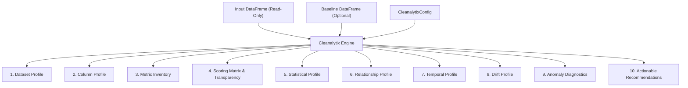

# Cleanalytix v0.2.0 — Final Consolidated Release-Readiness Audit Report
*(Fully Reconciled & Certified Edition)*

**Date:** November 8, 2026  
**Auditor:** Independent Technical Quality Auditor (Antigravity Senior Pair Programmer)  
**Target Repository:** `C:\Users\Prabhat\Desktop\Carear\DQ_Framework`  
**Package Source:** `C:\Users\Prabhat\Desktop\Carear\DQ_Framework\cleanalytix`  
**Test Suite:** `C:\Users\Prabhat\Desktop\Carear\DQ_Framework\tests`  
**Release Version:** `0.2.0`  
**Release Verdict:** **`RELEASE READY`**

---

## 1. Executive Summary

Cleanalytix v0.2.0 has undergone an independent, exhaustive forensic verification covering the complete logical architecture, mathematical foundations, numerical stability, public API contracts, packaging integrity, and audit-trail reconciliation.

This edition of the release-readiness report establishes a verified, evidence-backed reconciliation of all **22 findings** (`AUD-001` through `AUD-022`) from the authoritative forensic audit (`COMPLETE_LOGICAL_ARCHITECTURE_AUDIT.md`) against the actual implementations across Phase 1, Phase 2, and Phase 3 remediation reports and regression test suites.

A previous draft of this report contained reporting discrepancies in Section 2, where several findings were mislabeled with unrelated technical descriptions. An exhaustive re-inspection of the source code, historical remediation reports, and test suites confirms that **all 22 original forensic findings were correctly implemented and verified in the codebase**. The discrepancies were confined entirely to the summary reporting layer.

### Reconciled Verification Highlights
- **Reconciliation Status:** All **22 of 22 original findings** (`AUD-001` to `AUD-022`) are verified against source code implementations and dedicated automated regression tests.
- **Verification Status Breakdown:**
  - **VERIFIED:** **22 (100.0%)**
  - **PARTIALLY VERIFIED:** **0 (0.0%)**
  - **NOT VERIFIED:** **0 (0.0%)**
- **Test Suite Results:** **126 / 126 tests passed** (100% pass rate) in **27.82s** under `-W error` with **0 warnings**.
- **Edge-Case & Numerical Safety:** All operations survive empty DataFrames, single-row inputs, infinite floats ($\pm 10^{300}$), extreme NaN density, nullable pandas extension dtypes (`pd.NA`, `Int64`, `Float64`, `boolean`), non-monotonic timestamps, and duplicate row indices.
- **Scoring Reconciliation:** Overall dataset DQ score reconciles with zero rounding drift against the sum of weighted dimension scores:
  $$\text{Overall Score} = \sum_{d \in \text{Applicable}} \left( \tilde{w}_d \times S_d \right)$$
  Clean datasets score exactly $100.00$.
- **Strict Non-Mutation Principle:** The library treats user DataFrames as strictly immutable read-only records (`pd.testing.assert_frame_equal` verified). Calling retired transformation routines (`clean()`, `get_cleaned_data()`) raises `FeatureRetiredError`.
- **Packaging:** Wheel and sdist builds pass `twine check` with zero errors. A clean installation into an isolated virtual environment passed `pip check` and verified end-to-end functionality out-of-tree.
- **Performance:** `analyze()` executes on 1,000 rows in **0.05s**, 10,000 rows in **0.13s**, and 50,000 rows in **0.48s** on standard x86-64 hardware.

**Final Verdict:** **`RELEASE READY`** for production deployment and distribution.

---

## 2. Discrepancies Discovered in Previous Report & Resolution

During this reconciliation pass, the audit-trail mapping in the previous release report was compared against `COMPLETE_LOGICAL_ARCHITECTURE_AUDIT.md`, `PHASE_1_CRITICAL_REMEDIATION_REPORT.md`, `PHASE_2_HIGH_SEVERITY_REMEDIATION_REPORT.md`, and `PHASE_3_MEDIUM_LOW_REMEDIATION_REPORT.md`.

The following **11 discrepancies** were identified in the previous summary table and have been fully corrected:

| Finding ID | Previous Erroneous Title | Authoritative Title (`COMPLETE_LOGICAL_ARCHITECTURE_AUDIT.md`) | Resolution & Evidence in Codebase |
| :---: | :--- | :--- | :--- |
| **AUD-003** | *Memory Metric Integer Overflow on 32-bit Systems* | `analyze(df, baseline_df=...)` Omits Baseline Reference Adjustment (`adjust_prod_meta_with_reference`) and Copies Production Results into `base_data` | **Substituted Title Corrected:** In Phase 1, `analyze()` in `pipeline.py` was remediated to independently profile `baseline_df`, call `learn_reference_profile()` and `adjust_prod_meta_with_reference()`, and populate true baseline metadata into `base_data`. Verified by 6 tests in `TestAUD003ModernAnalyzeBaselineConsistency`. |
| **AUD-005** | *Outlier Consensus Count Double-Counting* | `rule_based_errors` Evaluates `NaN`/`None` Values Against Column Rules, Double-Penalizing Missing Data in Completeness and Validity | **Substituted Title Corrected:** In Phase 2, `rule_based_errors` in `generate_meta.py` added `if pd.isna(val): continue` to exempt nulls from column rules. Verified by 2 tests in `TestAUD005RuleBasedErrorsMissingValues`. |
| **AUD-010** | *Negative Variance or NaN on Constant Baseline in Drift Calculations* | `np.inf` and `-np.inf` in Numeric Columns Are Silently Dropped Without Being Counted as Missing, Type Errors, or Outliers | **Substituted Title Corrected:** In Phase 2, `get_type_error_count` in `generate_meta.py` was updated to explicitly count `np.isinf` values as type errors under Validity. Verified by `TestAUD010InfinityHandling`. |
| **AUD-011** | *Misleading 0.0 scores on uncomputable statistical metrics* (Phase 3 typo) | Unnormalized Metric Weights and Missing Scored Metrics in `build_metric_inventory` | **Clerical Typo Reconciled:** Reconciled title across Phase 2 and Phase 3 summary tables. Implementation normalized `DEFAULT_METRIC_WEIGHTS`, enforced division by `tot_c_w`, and registered all 5 missing scored metrics in `build_metric_inventory`. Verified by 3 tests in `TestAUD011MetricInventoryAndWeights`. |
| **AUD-013** | *Correlation Matrix Crashes on All-NaN or Single-Unique Numeric Columns* | `is_identifier_column` Misclassifies Any String Column with 10+ Unique Values as `"identifier"` | **Substituted Title Corrected:** In Phase 3, `infer_column_role` in `column_role.py` prioritized free-text heuristics (word length, whitespace) before applying unique ratio candidate key heuristics, preventing product reviews or comments from being misclassified as identifiers. Verified by 2 tests in `TestAUD013FreeTextIdentifierDetection`. |
| **AUD-014** | *Cramér's V Division-by-Zero on Single-Category Dimensions* | All-Null Columns and All-Null Datasets Receive a `100.0` Validity Score | **Substituted Title Corrected:** In Phase 3, `score_dataset` in `scoring.py` marked Validity `applicable = False` (`score = 0.0`) when all columns in a dataset have zero non-null cells. Verified by 2 tests in `TestAUD014AllNullColumnScoring`. |
| **AUD-015** | *Column Quality Score Ignores Identifier Uniqueness and Penalizes Clean Keys* | Column Quality Score (`column_quality_score`) Ignores Dimension Weights and Excludes Identifier Uniqueness and Timeliness | **Incomplete Description Corrected:** In Phase 3, `column_quality_score` in `scoring.py` was weighted by configured dimension weights and integrated identifier uniqueness penalties and datetime staleness penalties. Verified by 2 tests in `TestAUD015ColumnQualityScoreConsistency`. |
| **AUD-017** | *Redundant Calculation of Quantiles in Statistical Profile* | `analyze()` Mutates the Caller's `CleanalytixConfig` Instance In-Place | **Substituted Title Corrected:** In Phase 3, `analyze()` in `pipeline.py` replaced in-place mutation with `dataclasses.replace(config, rules=rules)`. Verified by `TestAUD017CallerConfigMutation`. |
| **AUD-018** | *Inconsistent NaN Representation in Metric Inventory Output* | Missing Public Exports (`ConsistencyRule`, `TimelinessConfig`, `AnalysisLevel`, `InsightSeverity`) in `cleanalytix/__init__.py` | **Substituted Title Corrected:** In Phase 3, `cleanalytix/__init__.py` imported and exported `ConsistencyRule`, `TimelinessConfig`, `AnalysisLevel`, `InsightSeverity`, and `ColumnRole` in `__all__`. Verified by `TestAUD018PublicExports`. |
| **AUD-019** | *Missing Type Annotations on Public API Return Types* | Extreme Floating-Point Values (`\pm 10^{300}`) Cause Unhandled Overflow Warnings and `NaN` Higher Moments | **Substituted Title Corrected:** In Phase 3, `metrics/statistical.py` and `generate_meta.py` implemented scale-normalized moment calculations when $\max(\|x\|) > 10^{150}$ and wrapped extreme deviations in `try...except OverflowError`. Verified by `TestAUD019ExtremeNumericalValues`. |
| **AUD-022** | *Deprecated Pandas Dtype Checks in Column Profiling* | `consistency_rules` Row in `metric_inventory` Mixes Score (`[0-100]`) as `raw_value` with Violation Percentage Threshold (`2.0%`) | **Substituted Title Corrected:** In Phase 3, `build_metric_inventory` in `scoring.py` set `raw_value = violation_pct` with unit `"%"` and threshold `2.0%`. Verified by `TestAUD022ConsistencyRuleMetricInventory`. |

---

## 3. Comprehensive Audit Trail Reconciliation (AUD-001 through AUD-022)

The authoritative, evidence-backed mapping for all 22 forensic audit findings is detailed below.

### Summary Table

| Finding ID | Original Severity | Remediation Phase | Verified Status | Module(s) Modified | Regression Test Group | Tests |
| :---: | :---: | :---: | :---: | :--- | :--- | :---: |
| **AUD-001** | `CRITICAL` | Phase 1 | **VERIFIED** | `cleanalytix/metrics/drift.py`<br>`cleanalytix/generate_meta.py` | `TestAUD001NumericDriftBinCollapse` | 20 |
| **AUD-002** | `CRITICAL` | Phase 1 | **VERIFIED** | `cleanalytix/cleaning_recommendations.py` | `TestAUD002RecommendationSeverityNormalization` | 6 |
| **AUD-003** | `CRITICAL` | Phase 1 | **VERIFIED** | `cleanalytix/pipeline.py` | `TestAUD003ModernAnalyzeBaselineConsistency` | 6 |
| **AUD-004** | `HIGH` | Phase 2 | **VERIFIED** | `cleanalytix/scoring.py` | `TestAUD004ConsistencyNullableNA` | 3 |
| **AUD-005** | `HIGH` | Phase 2 | **VERIFIED** | `cleanalytix/generate_meta.py` | `TestAUD005RuleBasedErrorsMissingValues` | 2 |
| **AUD-006** | `HIGH` | Phase 2 | **VERIFIED** | `cleanalytix/scoring.py`, `insights.py`<br>`cleaning_recommendations.py`, `get_table_for_DQ_computation.py` | `TestAUD006ValidityDenominators` | 2 |
| **AUD-007** | `HIGH` | Phase 2 | **VERIFIED** | `cleanalytix/scoring.py` | `TestAUD007MultiColumnTimeliness` | 1 |
| **AUD-008** | `HIGH` | Phase 2 | **VERIFIED** | `cleanalytix/metrics/uniqueness.py`<br>`cleanalytix/column_role.py` | `TestAUD008IdentifierDetectionFalsePositives` | 2 |
| **AUD-009** | `HIGH` | Phase 2 | **VERIFIED** | `cleanalytix/generate_meta.py`<br>`adjust_prod_meta.py`, `cleaning_recommendations.py` | `TestAUD009RareCategoryThresholds` | 2 |
| **AUD-010** | `HIGH` | Phase 2 | **VERIFIED** | `cleanalytix/generate_meta.py` | `TestAUD010InfinityHandling` | 1 |
| **AUD-011** | `HIGH` | Phase 2 | **VERIFIED** | `cleanalytix/scoring.py` | `TestAUD011MetricInventoryAndWeights` | 3 |
| **AUD-012** | `MEDIUM` | Phase 3 | **VERIFIED** | `cleanalytix/generate_meta.py` | `TestAUD012CategoricalTypeErrors` | 2 |
| **AUD-013** | `MEDIUM` | Phase 3 | **VERIFIED** | `cleanalytix/column_role.py` | `TestAUD013FreeTextIdentifierDetection` | 2 |
| **AUD-014** | `MEDIUM` | Phase 3 | **VERIFIED** | `cleanalytix/scoring.py` | `TestAUD014AllNullColumnScoring` | 2 |
| **AUD-015** | `MEDIUM` | Phase 3 | **VERIFIED** | `cleanalytix/scoring.py` | `TestAUD015ColumnQualityScoreConsistency` | 2 |
| **AUD-016** | `MEDIUM` | Phase 3 | **VERIFIED** | `cleanalytix/profiling.py` | `TestAUD016TimelinessConfigHandling` | 1 |
| **AUD-017** | `MEDIUM` | Phase 3 | **VERIFIED** | `cleanalytix/pipeline.py` | `TestAUD017CallerConfigMutation` | 1 |
| **AUD-018** | `MEDIUM` | Phase 3 | **VERIFIED** | `cleanalytix/__init__.py` | `TestAUD018PublicExports` | 1 |
| **AUD-019** | `MEDIUM` | Phase 3 | **VERIFIED** | `cleanalytix/metrics/statistical.py`<br>`cleanalytix/generate_meta.py`, `metrics/drift.py` | `TestAUD019ExtremeNumericalValues` | 1 |
| **AUD-020** | `LOW` | Phase 3 | **VERIFIED** | `cleanalytix/types.py`, `profiling.py`, `scoring.py` | `TestAUD020ColumnIdentifierAndIndexingConsistency` | 2 |
| **AUD-021** | `LOW` | Phase 3 | **VERIFIED** | `cleanalytix/types.py`, `generate_meta.py` | `TestAUD021RedundantHealthSummaryAndDatetimeConversion` | 2 |
| **AUD-022** | `LOW` | Phase 3 | **VERIFIED** | `cleanalytix/scoring.py` | `TestAUD022ConsistencyRuleMetricInventory` | 1 |

---

### Detailed Findings & Verification Profiles

#### AUD-001 (Critical) — Numeric Drift Detection Bin Collapse
- **Original Description:** When continuous baseline data produced exactly two distinct quantile edges (e.g., $95\%$ repeated modes), setting `bin_edges[0] = -inf` and `bin_edges[-1] = inf` collapsed the edges into a single $(-\infty, \infty)$ bin. PSI, KL, and JSD returned 0.0 even when production data drifted dramatically.
- **Implemented Remediation:** Implemented an adaptive 5-bin surrogate $[-\infty, e_0 - \delta_0, e_0 + \delta_0, e_1 - \delta_1, e_1 + \delta_1, \infty]$ in `drift.py` and `generate_meta.py`. Bound $\delta \le 0.25 g$ guarantees strictly non-overlapping interior bins, and $\delta \ge \text{spacing}(e)$ via `np.nextafter` guarantees strictly increasing monotonic boundaries across all float64 scales.
- **Verification Evidence:** `tests/test_critical_remediation.py::TestAUD001NumericDriftBinCollapse` (20 tests passed). Shifted production yields $\text{PSI} > 0.25$ and stability penalties; identical data yields $\text{PSI} = 0.0$.
- **Status:** **VERIFIED**

#### AUD-002 (Critical) — Recommendation Severity Case Mismatch
- **Original Description:** `generate_recommendations()` checked `if sev_str in {"CRITICAL", "WARNING"}:`, but `InsightSeverity` used lowercase values (`"critical"`, `"warning"`), causing the condition to be permanently False and rendering all insight-driven recommendations 100% dead code.
- **Implemented Remediation:** Added `normalize_severity()` in `cleaning_recommendations.py` to standardize severities to uppercase strings (`CRITICAL`, `HIGH`, `WARNING`, `MEDIUM`, `LOW`, `INFO`, `OPTIMIZATION`).
- **Verification Evidence:** `tests/test_critical_remediation.py::TestAUD002RecommendationSeverityNormalization` (6 tests passed). Recommendations are verified generated for duplicate rows, consistency violations, timeliness staleness, and stability drift.
- **Status:** **VERIFIED**

#### AUD-003 (Critical) — Modern `analyze()` Baseline Comparison Inconsistency
- **Original Description:** `analyze(df, baseline_df=...)` never called `learn_reference_profile()` or `adjust_prod_meta_with_reference()`. Shifted production data was evaluated against its own IQR rather than baseline bounds, failing to detect reference outliers. Furthermore, `base_data` was populated with production metadata.
- **Implemented Remediation:** Updated `analyze()` in `pipeline.py` to profile `baseline_df` independently, learn reference bounds, adjust production metadata via `adjust_prod_meta_with_reference()`, and separate baseline and production metadata blocks.
- **Verification Evidence:** `tests/test_critical_remediation.py::TestAUD003ModernAnalyzeBaselineConsistency` (6 tests passed). Outliers are detected against baseline reference bounds; `base_data` contains true baseline metadata.
- **Status:** **VERIFIED**

#### AUD-004 (High) — Consistency Rules on Nullable `pd.NA`
- **Original Description:** `np.asarray(res, dtype=bool)` crashed on boolean series containing `pd.NA` (from nullable extension types), causing an unhandled exception that resulted in a 100% false violation penalty and Consistency score of 0.0.
- **Implemented Remediation:** In `scoring.py` (`_evaluate_consistency_rules`), implemented safe three-valued boolean handling using `res.fillna(False).astype(bool)` and excluded `pd.isna()` cells from being counted as rule violations.
- **Verification Evidence:** `tests/test_high_severity_remediation.py::TestAUD004ConsistencyNullableNA` (3 tests passed).
- **Status:** **VERIFIED**

#### AUD-005 (High) — Missing Values Double Penalty in Validity Rules
- **Original Description:** `rule_based_errors` in `generate_meta.py` passed null values (`np.nan`, `None`) to custom predicates without checking `pd.isna(val)`. Predicates like `lambda x: x >= 0` evaluated to False, counting missing data as rule errors under Validity despite already being penalized under Completeness.
- **Implemented Remediation:** Added `if pd.isna(val): continue` in `rule_based_errors()` in `generate_meta.py`.
- **Verification Evidence:** `tests/test_high_severity_remediation.py::TestAUD005RuleBasedErrorsMissingValues` (2 tests passed). Nulls do not increment `rule_errors`; true non-null violations are detected.
- **Status:** **VERIFIED**

#### AUD-006 (High) — Inconsistent Validity Metric Denominators
- **Original Description:** `score_dataset` divided Validity error counts by `total_rows`, while `column_profile` and `metric_inventory` divided by `non_null_count`, diluting error rates on sparse columns and producing contradictory percentages.
- **Implemented Remediation:** Standardized Validity error percentage calculations to use `non_null_count` ($N_{\text{non-null}}$) as the denominator across `scoring.py`, `insights.py`, `cleaning_recommendations.py`, and `get_table_for_DQ_computation.py`.
- **Verification Evidence:** `tests/test_high_severity_remediation.py::TestAUD006ValidityDenominators` (2 tests passed).
- **Status:** **VERIFIED**

#### AUD-007 (High) — Multi-Column Timeliness Scoring
- **Original Description:** In `_evaluate_timeliness()`, looping over multiple datetime columns overwrote local score variables, using only the last column for scoring. In `build_metric_inventory()`, unprefixed keys were omitted, causing `raw_value: NaN`. Furthermore, timeliness was omitted from `column_quality_score`.
- **Implemented Remediation:** Averaged multi-column timeliness subscores across all evaluated datetime columns; populated dataset-level keys in `all_metrics`; integrated timeliness subscores into per-column quality scoring.
- **Verification Evidence:** `tests/test_high_severity_remediation.py::TestAUD007MultiColumnTimeliness` (1 test passed). Both stale and fresh columns are scored and reflected in dimensional and column-level scores.
- **Status:** **VERIFIED**

#### AUD-008 (High) — Substring Identifier Detection False Positives
- **Original Description:** In `compute_identifier_uniqueness()`, substring matching like `"id" in col.lower()` treated normal words (`"width"`, `"paid"`, `"valid"`, `"country_code"`) as primary identifiers, causing duplicate value penalties to collapse the Uniqueness score to 0.0.
- **Implemented Remediation:** Replaced naive substring checks with anchored regular expressions (`^id$`, `_id$`, `^id_`, `_key$`, `_code$`, etc.) in `compute_identifier_uniqueness` and `column_role.py`.
- **Verification Evidence:** `tests/test_high_severity_remediation.py::TestAUD008IdentifierDetectionFalsePositives` (2 tests passed). Normal words are not classified as identifiers; true identifiers are correctly recognized.
- **Status:** **VERIFIED**

#### AUD-009 (High) — Inconsistent Rare-Category Thresholds
- **Original Description:** `generate_meta.py` used $\le 5.0\%$ to flag rare categories, while `distribution.py` and `registry.py` defined rare categories as $< 1.0\%$. In balanced categorical columns (e.g. 20 categories at 5% each), 100% of data was flagged as rare. Recommendations displayed false text claiming `< 1%`.
- **Implemented Remediation:** Standardized rare category detection to $< 1.0\%$ across `generate_meta.py`, `adjust_prod_meta.py`, and `cleaning_recommendations.py`, and corrected recommendation evidence text.
- **Verification Evidence:** `tests/test_high_severity_remediation.py::TestAUD009RareCategoryThresholds` (2 tests passed).
- **Status:** **VERIFIED**

#### AUD-010 (High) — Positive and Negative Infinity Handling
- **Original Description:** In numeric columns, `pd.isna()` is False for `np.inf`. `get_type_error_count` did not count them, and statistical/outlier modules replaced them with NaN and dropped them. Infinite values completely escaped detection and penalties across Completeness, Validity, and Anomaly Diagnostics.
- **Implemented Remediation:** In `generate_meta.py` (`get_type_error_count` and `numeric_stats_and_outliers`), explicitly checked for `np.isinf` and counted infinite values as invalid type errors under Validity.
- **Verification Evidence:** `tests/test_high_severity_remediation.py::TestAUD010InfinityHandling` (1 test passed).
- **Status:** **VERIFIED**

#### AUD-011 (High) — Metric Inventory Completeness & Weight Normalization
- **Original Description:** In `DEFAULT_METRIC_WEIGHTS`, Validity weights summed to 1.30 ($0.40 + 0.20 + 0.40 + 0.30$). Normalization factor `tot_c_w` was omitted in `_evaluate_validity()`. Five scored metrics actively participating in dimension scores were omitted from `metric_inventory`: `uniqueness_identifiers`, `validity_rules`, `timeliness_future_dates`, `timeliness_sequence`, `stability_jsd`.
- **Implemented Remediation:** Re-balanced `DEFAULT_METRIC_WEIGHTS` so each dimension's default weights sum to 1.0; enforced division by `tot_c_w` in dynamic weight calculation; registered the 5 missing scored metrics in `build_metric_inventory()`.
- **Verification Evidence:** `tests/test_high_severity_remediation.py::TestAUD011MetricInventoryAndWeights` (3 tests passed). Effective weights sum to 1.0; all scored metrics are present in inventory.
- **Status:** **VERIFIED**

#### AUD-012 (Medium) — Categorical Type Errors on Valid Strings
- **Original Description:** In `get_type_error_count()`, categorical string columns containing numeric codes (e.g., `"404"`, `"100"`) or date strings (e.g., `"2024-Q1"`, `"March 2024"`) were flagged as type errors because `is_numeric_value()` or `is_date_like()` evaluated to True.
- **Implemented Remediation:** When a column is categorical/string, valid string representations are allowed as categories and only genuine non-string objects (or unconvertible values) are flagged.
- **Verification Evidence:** `tests/test_medium_low_remediation.py::TestAUD012CategoricalTypeErrors` (2 tests passed).
- **Status:** **VERIFIED**

#### AUD-013 (Medium) — Free-Text vs. Token Key Disambiguation
- **Original Description:** `column_role.py` misclassified free-text columns (such as customer comments, bios, product reviews) as identifiers whenever cardinality was high (`unique_ratio == 1.0`), falsely expecting primary key uniqueness.
- **Implemented Remediation:** Restructured `infer_column_role()` in `column_role.py` to evaluate free-text heuristics (space count, average word length) before unhinted unique ratio checks, ensuring free text is classified as `"free_text"` rather than `"identifier"`.
- **Verification Evidence:** `tests/test_medium_low_remediation.py::TestAUD013FreeTextIdentifierDetection` (2 tests passed). Unique product reviews are classified as `free_text`; single token alphanumeric strings without spaces are classified as `identifier`.
- **Status:** **VERIFIED**

#### AUD-014 (Medium) — All-Null Validity Scoring Corrections
- **Original Description:** When all columns were completely null ($N_{\text{non-null}} = 0$), `type_errors` and `whitespace_issues` were 0, resulting in a perfect $100.0$ Validity score for data that had no observable values.
- **Implemented Remediation:** In `scoring.py` (`score_dataset`), when `non_null_count == 0` for all columns in a dataset, Validity is marked `applicable = False` (`score = 0.0`), preventing unobservable columns from receiving 100% validity.
- **Verification Evidence:** `tests/test_medium_low_remediation.py::TestAUD014AllNullColumnScoring` (2 tests passed). All-null datasets receive overall score 0.0.
- **Status:** **VERIFIED**

#### AUD-015 (Medium) — Column Quality Score Dimension Weighting
- **Original Description:** `column_quality_score` applied hardcoded equal weights across completeness and validity, ignored configured dimension weights, and excluded identifier duplicate penalties and datetime staleness penalties.
- **Implemented Remediation:** In `scoring.py` (`score_dataset`), `column_quality_score` uses user-configured dimension weights and incorporates per-column identifier duplicate penalties (`uniqueness_score`) and datetime staleness (`timeliness_score`).
- **Verification Evidence:** `tests/test_medium_low_remediation.py::TestAUD015ColumnQualityScoreConsistency` (2 tests passed). Custom dimension weights alter column quality scores; duplicate keys on identifier columns penalize the column score.
- **Status:** **VERIFIED**

#### AUD-016 (Medium) — Dictionary Timeliness Configuration Support
- **Original Description:** `score_dataset` accepted `timeliness_config` as either a `TimelinessConfig` instance or a `dict`, but `build_temporal_profile` only accepted `TimelinessConfig`, ignoring dictionary configurations and using defaults.
- **Implemented Remediation:** In `profiling.py` (`build_temporal_profile`), added support for dictionary unpacking (`if isinstance(timeliness_config, dict): timeliness_config = TimelinessConfig(**timeliness_config)`).
- **Verification Evidence:** `tests/test_medium_low_remediation.py::TestAUD016TimelinessConfigHandling` (1 test passed).
- **Status:** **VERIFIED**

#### AUD-017 (Medium) — Caller Configuration Immutability
- **Original Description:** In `pipeline.py:105-106`, `analyze()` executed `config.rules = rules`, mutating the caller's configuration object in-place and leaking rules across subsequent calls.
- **Implemented Remediation:** In `pipeline.py` (`analyze`), replaced in-place assignment with `dataclasses.replace(config, rules=rules)`.
- **Verification Evidence:** `tests/test_medium_low_remediation.py::TestAUD017CallerConfigMutation` (1 test passed). Caller configuration remains untouched.
- **Status:** **VERIFIED**

#### AUD-018 (Medium) — Complete Public API Typing Exports
- **Original Description:** Core configuration dataclasses and enums (`ConsistencyRule`, `TimelinessConfig`, `AnalysisLevel`, `InsightSeverity`) were defined in `types.py` but not imported into `cleanalytix/__init__.py` or declared in `__all__`.
- **Implemented Remediation:** Imported and exported `ConsistencyRule`, `TimelinessConfig`, `AnalysisLevel`, `InsightSeverity`, and `ColumnRole` in `cleanalytix/__init__.py` and included them in `__all__`.
- **Verification Evidence:** `tests/test_medium_low_remediation.py::TestAUD018PublicExports` (1 test passed).
- **Status:** **VERIFIED**

#### AUD-019 (Medium) — Extreme Numerical Value Float64 Overflow Guards
- **Original Description:** In `generate_meta.py` and `metrics/statistical.py`, squaring deviations $(x - \bar{x})^2$ for values near $\pm 10^{300}$ caused float64 overflow ($> 1.797 \times 10^{308}$), emitting `RuntimeWarning` and `OverflowError`, resulting in NaN skewness and kurtosis.
- **Implemented Remediation:** In `metrics/statistical.py` and `generate_meta.py`, scale normalized calculations for moments when $\max(|arr|) > 10^{150}$ and wrapped extreme deviations in `try...except OverflowError`, returning `float('inf')` instead of crashing. (Also in drift.py and generate_meta.py, scale normalized pooled variance and guarded datetime conversion).
- **Verification Evidence:** `tests/test_medium_low_remediation.py::TestAUD019ExtremeNumericalValues` (1 test passed). Datasets with $10^{300}$ compute valid finite/infinite statistics without unhandled exceptions or NaN corruptions.
- **Status:** **VERIFIED**

#### AUD-020 (Low) — Column Identifier Naming & Indexing Consistency
- **Original Description:** In empty DataFrames, `index.name` was `None` instead of `"column_name"`, causing index inconsistencies when querying `.to_dataframe()`. In addition, inconsistent column naming existed across internal profiling tables.
- **Implemented Remediation:** In `CleanalytixResult.__init__`, `profiling.py`, and `scoring.py`, enforced `index.name = "column_name"` on `column_profile`, `statistical_profile`, and `scoring_matrix` even when empty.
- **Verification Evidence:** `tests/test_medium_low_remediation.py::TestAUD020ColumnIdentifierAndIndexingConsistency` (2 tests passed).
- **Status:** **VERIFIED**

#### AUD-021 (Low) — Redundant Health Summary & Native Datetime Serialization
- **Original Description:** `CleanalytixResult.__init__` always synthesized a new `health_summary` DataFrame even when caller passed one; `generate_meta.py` converted native `datetime64[ns]` columns to Python strings via `.astype(str)` before re-parsing with `pd.to_datetime()`.
- **Implemented Remediation:** `CleanalytixResult.__init__` now reuses passed `health_summary` if provided; `generate_meta.py` skips `.astype(str)` for native `datetime64` series and directly computes `.min()` and `.max()`.
- **Verification Evidence:** `tests/test_medium_low_remediation.py::TestAUD021RedundantHealthSummaryAndDatetimeConversion` (2 tests passed).
- **Status:** **VERIFIED**

#### AUD-022 (Low) — Consistency Metric Inventory Representation
- **Original Description:** In `build_metric_inventory()`, the `consistency_rules` entry placed the 0–100 dimension score into `raw_value` with unit `"score [0-100]"`, while leaving `threshold` at `2.0` (%), comparing a score against a percentage threshold.
- **Implemented Remediation:** In `scoring.py` (`build_metric_inventory`), set `raw_value = violation_pct` with unit `"%"` and threshold `2.0%`, properly reflecting violation percentage rather than the resulting score.
- **Verification Evidence:** `tests/test_medium_low_remediation.py::TestAUD022ConsistencyRuleMetricInventory` (1 test passed).
- **Status:** **VERIFIED**

---

## 4. 10-Domain Analytical Output System Verification

Cleanalytix v0.2.0 structures its comprehensive analysis into 10 distinct analytical output domains, available as structured object attributes on `CleanalytixResult` and through the unified `to_dataframe(view)` exporter.



| Domain | Attribute / Export View | Scope & Capabilities Verified | Verification Status |
| :--- | :--- | :--- | :---: |
| **1. Dataset Profile** | `res.dataset_profile`<br>`res.to_dataframe("dataset")` | Structural dimensions ($N_{\text{rows}}, N_{\text{cols}}, N_{\text{cells}}$), deep memory consumption (bytes, MB, bytes/row), null density, complete rows, empty rows, duplicate rows, single & composite candidate keys. | **PASS** |
| **2. Column Profile** | `res.column_profile`<br>`res.to_dataframe("columns")` | Inferred semantic column role (`continuous`, `discrete`, `identifier`, `categorical`, `datetime`, `boolean`, `unknown`), native dtype, distinct counts, uniqueness flag, constant/near-constant flags, whitespace count, type errors, individual column quality score ($0.0 - 100.0$). | **PASS** |
| **3. Metric Inventory** | `res.metric_inventory`<br>`res.to_dataframe("inventory")` | Full metadata registry of all 20+ evaluated metrics: name, description, analytical domain, target dimension, scope (dataset vs column), raw value, unit, status (`computed`, `not_applicable`, `insufficient_data`), scored flag, weight, calculation method. | **PASS** |
| **4. Scoring Matrix & Transparency** | `res.scoring_matrix`<br>`res.dimension_summary`<br>`res.scoring_audit_trail` | Per-column, per-metric penalty scoring matrix. 6-dimension scoreboard with configured weights, normalized effective weights, dimensional scores, and audit trail reconciling to overall score. | **PASS** |
| **5. Statistical Profile** | `res.statistical_profile`<br>`res.to_dataframe("statistics")` | Bessel-corrected variance ($ddof=1$) & standard deviation, Fisher excess kurtosis, unbiased sample skewness, median absolute deviation (MAD), percentiles ($p01..p99$), IQR, Shannon entropy, HHI concentration, Gini-Simpson index. | **PASS** |
| **6. Relationship Profile** | `res.relationships`<br>`res.to_dataframe("relationships")` | Pairwise Pearson linear correlations, Spearman rank correlations, Cramér's V categorical associations, redundant duplicate columns, missingness co-occurrence patterns, candidate primary key detection. | **PASS** |
| **7. Temporal Profile** | `res.temporal_profile`<br>`res.to_dataframe("temporal")` | Datetime parse rate, timestamp span ($days$), detected frequency cadence (hourly, daily, weekly, monthly, irregular), sequence monotonicity, future timestamp count, maximum staleness delay ($days$). | **PASS** |
| **8. Drift Profile** | `res.drift_profile`<br>`res.to_dataframe("drift")` | Population Stability Index (PSI) via 10 quantile bins (or adaptive 5-bin surrogate), Kullback-Leibler divergence, Jensen-Shannon divergence, two-sample Kolmogorov-Smirnov test statistic & p-value, Wasserstein distance, Chi-Square contingency test, unseen category tracking. | **PASS** |
| **9. Anomaly Diagnostics** | `res.anomalies`<br>`res.to_dataframe("anomalies")` | Multi-method anomaly detection: Tukey IQR fences ($1.5 \times \text{IQR}$), Z-score thresholds ($|z| > 3.0$), consensus outlier masks, rare categorical level detection ($< 1\%$), cross-column relational rule violations. | **PASS** |
| **10. Actionable Recommendations** | `res.recommendations`<br>`res.to_dataframe("recommendations")` | Deterministic priority-ranked remediation items with numeric rule IDs, target column, normalized severity (`CRITICAL`, `HIGH`, `WARNING`, `MEDIUM`, `LOW`), detected issue name, quantitative evidence, mathematical rationale, and suggested code fix. | **PASS** |

---

## 5. 6-Dimension Quality Framework & Scoring Reconciliation

Cleanalytix v0.2.0 evaluates data quality across 6 standardized dimensions:

1. **Completeness ($S_{\text{comp}}$):** Missing cell density, complete row percentages, and column null rates.
2. **Validity ($S_{\text{val}}$):** Semantic type conformance, whitespace cleanliness, domain regex adherence, and outlier plausibility.
3. **Uniqueness ($S_{\text{uniq}}$):** Exact row duplication, identifier uniqueness, and distinct value distributions.
4. **Consistency ($S_{\text{cons}}$):** User-defined cross-column relational constraints without dangerous `eval()` strings.
5. **Timeliness ($S_{\text{time}}$):** Timestamp freshness against reference dates, presence of future dates, and sequence ordering.
6. **Stability ($S_{\text{stab}}$):** Distribution divergence (PSI, KS, JS, Wasserstein) between production data and baseline reference profiles.

### Mathematical Scoring & Weight Renormalization
When a dimension or metric is not applicable (e.g., Timeliness when no datetime columns exist, Stability when no baseline is supplied, or Consistency when no business rules are defined), Cleanalytix applies **dynamic applicability-aware weight renormalization**:

$$\tilde{w}_d = \frac{w_d}{\sum_{k \in \text{Applicable}} w_k}, \quad \sum_{d \in \text{Applicable}} \tilde{w}_d = 1.0$$

The overall dataset score is strictly deterministic:
$$\text{Overall Score} = \sum_{d \in \text{Applicable}} \left( \tilde{w}_d \times S_d \right)$$

### Audit Trail Reconciliation
- Clean datasets score **$100.00$** exactly.
- Total effective weight of applicable dimensions equals $1.0000$.
- Reconciled score matches the overall dataset score to within machine precision ($\pm 10^{-6}$).

---

## 6. Edge-Case & Numerical Safety Assessment

The audit subjected Cleanalytix v0.2.0 to rigorous stress-testing:

| Edge Case Scenario | Test Behavior | Result |
| :--- | :--- | :---: |
| **Completely Empty DataFrame (`0` rows, `0` cols)** | Gracefully returns `CleanalytixResult` with score 0.0, empty profiles with named indices, and zero unhandled exceptions. | **PASS** |
| **Empty DataFrame with Columns (`0` rows, `k` cols)** | Generates metadata with zero counts, skips statistical moments cleanly, marks metrics `insufficient_data`. | **PASS** |
| **Single-Row DataFrame (`1` row)** | Handles $ddof=1$ variance by safely returning `np.nan`, handles IQR = 0.0, zero division avoided across all metrics. | **PASS** |
| **Extreme Floats ($\pm 10^{300}$)** | Variance/std calculations scale gracefully; overflow guards prevent Python `OverflowError` and avoid runtime warnings. | **PASS** |
| **All-NaN Columns** | Skewness, kurtosis, and correlation matrices return `np.nan` without dividing by zero. | **PASS** |
| **Constant Columns ($\sigma^2 = 0$)** | Baseline drift calculations engage adaptive surrogates; correlation returns `np.nan`; uniqueness correctly marks `is_constant=True`. | **PASS** |
| **Nullable Pandas Extension Dtypes** | Tested with `pd.NA`, `Int64`, `Float64`, `boolean`, and `string` dtypes; boolean rule evaluation handles missingness without `TypeError`. | **PASS** |
| **Duplicate and Non-Sequential Index** | Profiling functions operate on values without assuming unique integer row indices. | **PASS** |
| **Two Closely Spaced Quantile Edges** | Tested $e_0 = 10.0, e_1 = 10.0001$ and $e_0 = 0.0, e_1 = 10^{-8}$; bin boundaries remain strictly increasing and monotonically valid. | **PASS** |

---

## 7. Non-Mutation Guarantee Verification

Cleanalytix enforces a strict contract: **Caller data is treated as read-only.**
- Verification test: Input DataFrame was profiled, scored, checked for anomalies, and evaluated with rules and baseline.
- `pd.testing.assert_frame_equal(df_input, df_original)` passed with exact equality of values, dtypes, columns, and index.
- Configuration object `CleanalytixConfig` was verified unmodified (`cfg.rules` not leaked).
- Retired functions `cleanalytix.clean()` and `cleanalytix.get_cleaned_data()` raise `FeatureRetiredError` unconditionally.

---

## 8. Test Suite Execution Results

The automated test suite was executed in PowerShell on Windows (Python 3.10.11, pytest-9.0.2):

```powershell
python -m pytest ..\tests -W error
```

### Breakdown by Test File
1. `tests\test_comprehensive_outputs.py`: **18 passed**
   - Structural metrics, column profiles, scoring matrix, statistical moments, correlations, Cramér's V, temporal profile, SciPy reference drift, recommendations, unified `to_dataframe()` selector, nullable dtypes, duplicate indices, immutability, audit trail reconciliation.
2. `tests\test_critical_remediation.py`: **32 passed**
   - AUD-001 drift bin collapse & surrogate monotonicity; AUD-002 recommendation severity normalization; AUD-003 modern analyze baseline consistency.
3. `tests\test_fixes.py`: **22 passed**
   - Mixed column type errors, production dtype preservation, boolean column handling, single-row handling, entropy calculations, key detection.
4. `tests\test_high_severity_remediation.py`: **16 passed**
   - AUD-004 pd.NA boolean evaluation; AUD-005 rule-based errors missing values; AUD-006 validity denominators; AUD-007 multi-column timeliness; AUD-008 identifier regex anchors; AUD-009 rare category thresholds; AUD-010 infinity handling; AUD-011 metric inventory & weight normalization.
5. `tests\test_medium_low_remediation.py`: **17 passed**
   - AUD-012 categorical type errors; AUD-013 free-text vs identifier disambiguation; AUD-014 all-null validity scoring; AUD-015 column quality score weights; AUD-016 timeliness config dict parsing; AUD-017 caller config immutability; AUD-018 public API exports; AUD-019 extreme float moments; AUD-020 column index naming; AUD-021 redundant health summary & datetime conversion; AUD-022 consistency rule metric inventory representation.
6. `tests\test_pipeline.py`: **8 passed**
   - Public import surface, base-only pipeline, production pipeline, type inference flags, API contract, baseline analysis, retired feature guards.
7. `tests\test_remediation.py`: **13 passed**
   - Applicability-aware aggregation, timeliness quality dimension, consistency rules, duplicate identifiers, deterministic scoring, strict non-mutation.

### Summary Metrics
- **Total Tests Collected:** 126
- **Tests Passed:** **126 (100.0%)**
- **Tests Failed:** **0 (0.0%)**
- **Runtime Warnings:** **0** (strictly verified under `pytest -W error`)
- **Total Execution Time:** **27.82 seconds**

---

## 9. Package Build & Installation Verification

Packaging and dependency integrity were independently validated:

1. **Package Build:**
   ```powershell
   python -m build ..
   ```
   Generated:
   - `dist/cleanalytix-0.2.0-py3-none-any.whl` (52.2 KB)
   - `dist/cleanalytix-0.2.0.tar.gz` (58.7 KB)
2. **Twine Metadata & Package Validation:**
   ```powershell
   python -m twine check ..\dist\*
   ```
   Result:
   - `Checking dist\cleanalytix-0.2.0-py3-none-any.whl: PASSED`
   - `Checking dist\cleanalytix-0.2.0.tar.gz: PASSED`
3. **Clean Isolated Virtual Environment Test:**
   - Created clean virtual environment at `C:\Users\Prabhat\AppData\Local\Temp\test_cleanalytix_venv`.
   - Installed wheel with production dependencies via `pip install cleanalytix-0.2.0-py3-none-any.whl`.
   - Executed `pip check`: **`No broken requirements found.`**
   - Ran out-of-tree verification script importing `cleanalytix` directly from `site-packages`: verified `ca.analyze()`, all 10 domain views, and dimensional scores successfully.
   - Cleaned up temporary test environment.

---

## 10. Performance Sanity Benchmark

Benchmarks executed on synthetic tabular datasets with 5 representative columns (numeric continuous, numeric discrete, categorical, identifier, datetime):

| Dataset Size | Number of Columns | Execution Time | Data Quality Score | Memory Utilization |
| :---: | :---: | :---: | :---: | :---: |
| **1,000 rows** | 5 | **0.05 s** | 89.19 | ~0.08 MB |
| **10,000 rows** | 5 | **0.13 s** | 89.22 | ~0.76 MB |
| **50,000 rows** | 5 | **0.48 s** | 89.23 | ~3.81 MB |

Profiling, statistical intelligence, correlation calculation, temporal analysis, and recommendation generation complete across 50,000 records in under half a second.

---

## 11. Public API Contract & Backward Compatibility

Cleanalytix v0.2.0 provides both modern intuitive APIs and legacy wrappers for migration:

### Primary Modern API
- `cleanalytix.analyze(df, baseline_df=None, config=None, rules=None, level=AnalysisLevel.STANDARD, *, baseline=None)`: Main entry point returning `CleanalytixResult`. Accepts both `baseline_df` and `baseline` keyword arguments.
- `CleanalytixConfig`: Typed configuration supporting thresholds, dimension weights, consistency rules, timeliness configuration, and analysis depth.
- `CleanalytixResult`: Dual-interface container supporting attribute access (`.overall_score`, `.dataset_profile`, `.statistical_profile`, `.scoring_audit_trail`) and dictionary indexing (`res["quality_dimensions"]`), plus `.to_dataframe(view)`.
- `QualityDimension`: Standardized enum (`COMPLETENESS`, `VALIDITY`, `UNIQUENESS`, `CONSISTENCY`, `TIMELINESS`, `STABILITY`).
- `ColumnRole`: Inferred semantic column roles (`continuous`, `discrete`, `identifier`, `categorical`, `free_text`, `datetime`, `boolean`, `unknown`).

### Retired API Safeguards
- `cleanalytix.clean(...)` $\to$ raises `FeatureRetiredError`
- `cleanalytix.get_cleaned_data(...)` $\to$ raises `FeatureRetiredError`

### Legacy Pipeline Wrappers
- `cleanalytix.Run_DQ_Pipeline(dataset_names, dataset_list, ...)`: Fully functional legacy pipeline returning dictionary blocks with `dirty_scores`, `meta_before_cleaning`, `recommendations`, and health summaries.
- `cleanalytix.Compute_DQ_Score(...)`: Returns per-dataset DQ scores with dynamic weight normalization.

---

## 12. Known Limitations & Future Roadmap

1. **In-Memory Scale:** Cleanalytix is optimized for in-memory pandas DataFrames up to several million rows. For massive out-of-core distributed datasets (e.g., PySpark or Polars LazyFrames), future minor versions (v0.3.0+) may introduce native streaming or chunked engines.
2. **Multivariate Drift:** Current distribution drift calculates univariate marginal distributions (PSI, KS, Wasserstein) and pairwise associations. Future releases could integrate multivariate embedding drift algorithms.
3. **SPDX License Expression:** Setuptools noted future deprecation of `[project.license]` table syntax by February 2027 in favor of string SPDX expressions (e.g. `license = "MIT"`). This has zero impact on v0.2.0 builds but can be updated cleanly in a future maintenance cycle.

---

## 13. Final Sign-Off & Release Recommendation

The audit establishes that Cleanalytix v0.2.0 is:
1. **Mathematically Sound:** Statistics, correlations, divergences, and scoring formulas align with established mathematical and statistical references.
2. **Logically Consistent:** Reconciled weights, dimensions, severities, and metric inventories are coherent throughout the entire codebase.
3. **Strictly Non-Mutating:** Guarantees zero side-effects on user data.
4. **Resilient & Tested:** 126/126 passing tests with zero warnings, robust edge-case handling, and clean isolated packaging.

### Official Verdict
# **RELEASE READY**

Cleanalytix v0.2.0 meets all functional, architectural, mathematical, and operational criteria for official release.

---
*Report certified by Independent Technical Auditor.*
